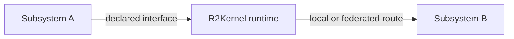

# Communication Surfaces

R2Kernel subsystem interfaces describe communication intent. Subsystem code uses
the same contract whether both subsystems run on one host or the deployment
places them on different hosts.

The runtime owns transport realization, route selection, and host-boundary
policy. Those implementation choices are not part of the subsystem contract.

## Semantic Surfaces

| Surface | Use |
| --- | --- |
| Event | observations, state, telemetry, and fanout streams |
| Control | periodic commands with validity, deadline, and overrun semantics |
| Procedure | bounded request and response |
| Operation | long-running work with progress, cancellation, result, and terminal state |

An API contract declares one or more endpoint kinds. A Procedure cannot
substitute for a Control endpoint, and an Event publisher cannot be used as a
request/response provider. Role policy is checked against the endpoint kinds in
the resolved contracts, including APIs selected through compound exports.

## Role Policy

| Role or route | Allowed surfaces |
| --- | --- |
| App interfaces, both required and provided | Event, Procedure, Operation |
| App to Component | Event, Procedure, Operation; direct binding is allowed |
| App to Compound | Event, Procedure, Operation through an export sourced from a Component |
| App or Compound to Gateway | No direct binding |
| Compound interfaces | Declarative `component.*` requirements and Event/Procedure/Operation API exports; no own `provides` endpoints |
| Component to Gateway | Components may bind to gateway Control for periodic device commands |
| Gateway endpoints | Control-only public contracts and explicit internal Controls; no Event, Procedure, or Operation registrations |

Compound requirements may select `component.*` bundles whose conformance APIs
include Control endpoints for device integration. The compound only declares
the component requirement and its port/export mapping; it does not invoke a
Control endpoint. An app-facing export must resolve to a component API that has
no Control endpoints.

Apps use Event interfaces for streaming interaction, Procedures for bounded
request/response calls, and Operations for work with progress or cancellation.
For example, a component can terminate an app Event stream and use a timed
Control exchange to drive a gateway. Device observations that need an Event,
Procedure, or Operation are exposed by a Component adapter rather than by the
Gateway.

## Host Boundary

The deployment may place a valid binding on one host or across multiple hosts.
That placement changes latency, availability, and timing acceptance, but it does
not change the declared API contract.

For a local route, the runtime selects a host-local data path. For a federated
route, host control services establish the accepted remote path. Subsystems do
not open ad hoc remote control listeners or encode host topology into application
logic.

The runtime reports whether a provider route is available. A consumer with a
declared binding remains `WaitingTarget` until its selected provider can be
resolved.

## Event

Event is the observation and fanout surface.

- publishers publish one declared Event endpoint
- subscribers bind to that endpoint
- one publisher may have multiple subscribers
- delivery status and timing are observable through runtime status
- Event is not a reliable substitute for command acknowledgement

Event payloads remain domain messages. Public SDK timestamp fields and callback
metadata distinguish acquisition, publication, and reception times where
supported by the API. Their clock and validity contracts are public; the
runtime's transport-envelope representation is private and is not an
application wire format.

## Control

Control is a point-to-point periodic command surface. Its contract may declare:

- expected period
- validity and deadline behavior
- late handling
- priority
- request and response message types

A required Control binding selects one provider. Use an explicit higher-level
mirror or fanout subsystem when one command must be applied to multiple targets.
Several distinct Components may select the same Gateway Control provider. Each
source has an independent point-to-point session; the provider interface and
handler remain single. This is multiple callers of one device contract, not a
single command fanned out to multiple devices.

For a Component-to-Gateway actuator link, Control can model continuously
asserted physical intent even when its payload is only one Boolean bit. Each
accepted refresh renews a bounded validity lease when the API declares that
behavior. Existing Controls keep their existing expiry semantics; the
versioned `common_control` profile is described in [Control Cycles and Typed
Streams](../spec/control-cycles-and-streaming.md). App-to-Component streams use
Event endpoints; the Component owns any translation into the Gateway's timed
Control contract.

## Procedure And Operation

Procedure is intended for bounded calls such as configuration, status queries,
or discrete actions.

Operation is intended for work that outlives one request. It exposes start,
progress, state, cancellation, and terminal result according to its API
contract. Operation progress does not create a new public interface for every
invocation.

## Browser And External Clients

Browsers and outside-runtime tools use the Host Control API rather than native
subsystem transport.

- `/api/v1/ws/events` observes declared Event endpoints
- `/api/v1/ws/control` invokes supported Procedure and Operation endpoints
- REST routes provide host status, configuration, package, and lifecycle APIs

This facade is an integration boundary. It does not expose synchronized Control
execution or native transport ownership to browser code.

## Practical Rule

- subsystem authors declare semantic interfaces
- deployment authors select instances and bindings
- the runtime owns route realization
- operators validate availability, timing, and health through runtime status
- external clients use the documented Host Control API

## Related Pages

- [Subsystem Binding Model](../concepts/subsystem-binding-model.md)
- [Federation and Host Control](federation-and-host-control.md)
- [Federation Time Model](federation-time-model.md)
- [Host Control WebSocket API](../api/host-control-websocket-api.md)
