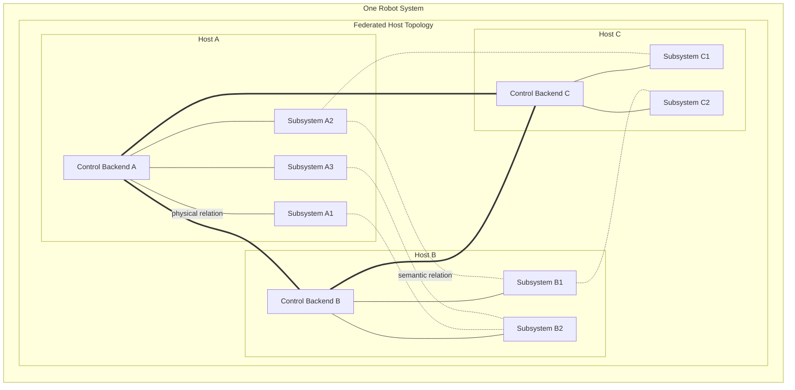

# Host, Control Backend, and Federation

The semantic model of R2Kernel is subsystem-to-subsystem interaction.

Application code should primarily think in terms of.

- which subsystem provides a capability
- which subsystem consumes that capability
- which semantic surface is being used, such as Event, Control, Procedure, or Operation

That semantic model stays valid even when the deployment grows across multiple machines.

## Why This Architectural Layer Exists

A practical robot system rarely remains one sealed software stack on one machine for long.

Semantically, R2Kernel wants the system to be understood as a set of cooperating subsystems.

Architecturally, those subsystems need real execution environments.

- component compute machines
- gateway or field-interface machines
- perception compute nodes
- UI or supervisory nodes
- diagnostics or integration nodes

In other words, the semantic unit is the subsystem, but the deployment has to be organized around real machines and network boundaries.

For that reason, a real robot system usually grows into a distributed system shape even if it starts from a smaller local deployment. Different hardware interfaces, compute requirements, isolation needs, and network boundaries push different subsystem roles toward different machines.

This does not mean R2Kernel requires every deployment to span multiple machines from day one. Single-machine composition is supported. But the architecture is designed around the fact that many practical robot systems eventually need multiple machines.

Once R2Kernel is deployed in that kind of environment, the system needs architectural boundaries for these concerns.

- machine-local subsystem lifecycle
- status aggregation
- route metadata
- remote visibility
- cross-machine forwarding and relay policy

That is why R2Kernel introduces three architectural concepts.

- a host as the deployment boundary
- a control backend as the host-level control plane
- federation as the cross-machine relation

These concepts solve deployment and network structure efficiently without changing the semantic model that user code sees.

## Host

A host is the machine that runs one deployment unit of the robot system.

It is the place where R2Kernel groups together.

- one control backend instance
- one or more local subsystems
- managed subsystem packages and resource leases
- local transport paths
- optional host-level time-sync processes

So while the semantic model is subsystem-oriented, the deployment boundary is host-oriented.

## Control Backend

The control backend is the control plane for one host.

It owns the following.

- subsystem registration and status aggregation
- managed package launch and host-local resource authority
- host-level discovery and route metadata
- remote visibility of local subsystem capability
- cross-host forwarding and relay policy
- browser-facing or API-facing status surfaces

This is why a subsystem does not need to own remote machine topology directly in application code.

## Federation

Federation is the relation between hosts.

It does not mean that a subsystem itself stretches across hosts. It means the following.

- one host exports the relevant visibility of its local subsystems
- another host learns that visibility through its control backend
- remote delivery and control are resolved through the host-level runtime path

So the user-facing semantics are subsystem-to-subsystem, but the actual cross-host realization is host-to-host through control-managed federation.

Federation security also belongs at this host-to-host boundary. Subsystems do
not manage peer credentials or network security directly. Operators must
configure the host API access policy, secured federation frames, and native-port
firewall policy separately; one enabled security switch does not protect every
communication surface. A shared federation key establishes membership in the
configured trust group, not supplier certification or independent package
identity. Inspect host status and diagnostics and test both authorized and
rejected peer access before enabling robot workloads. See
[Web and API Security](../operate/web-and-api-security.md).

Inbound Event delivery requires a fresh accepted peer/publisher/topic
registration with compatible codec metadata. Queued samples retain that
accepted publisher lifetime. Registration withdrawal, expiry, quarantine, or a
publisher lifetime change retires its old queued samples; accepting a fresh
registration admits new arrivals, not a replay of retired samples. Event
subscriptions do not require a Control binding.

This is a receiver admission and queue-lifetime guarantee, not cryptographic
isolation between publishers inside a shared-key trust group. A trusted peer
can assert publisher names. Bytes buffered in transport before a restart but
first received after a new registration cannot be distinguished from fresh
bytes by this contract. Metadata readiness does not establish a per-packet
session proof, zero-delay freshness, or cross-host real-time qualification.

Runtime peer admission is a scoped, revisioned management operation. A successful
removal or replacement retires affected Event sessions, retained samples and
Control work; stale discovery cannot restore the removed admission.
Local Control protocol v5 and SHM layouts are unchanged. Management changes may
contend with active work and do not provide real-time isolation. See
[Runtime Federation Peers](../api/host-control-rest-api.md#runtime-federation-peers).

This does not make shared-key peers mutually hostile tenants. Event frames share
the configured PSK trust domain; Control forwarding authenticates its
envelope but does not encrypt its payload. Production keys come from the broker's
protected `federation_key_path`; direct key/environment/file resolver fixtures are
test-only, not an alternative production credential path. Upgrade federation
hosts together. Keyring reloads rotate the trust-group key without a restart; see
[Federation Key Rotation](../api/host-control-rest-api.md#federation-key-rotation).
A platform must stop/fence an old Station and quarantine reused addresses before
admission; r2kernel neither owns VPN lifecycle nor configures firewall ports. Package UID separation protects manager authority, not
per-package confidentiality inside the shared IPC group.

## Architectural View

In this architecture.

- each host runs one control backend
- each control backend manages multiple host-local subsystems
- federation is shown as the host-topology layer, not as a named subsystem interface
- the multi-host deployment is one robot system, not several unrelated systems
- solid lines show physical host-local relation
- thick lines show the federation relation between hosts
- dotted lines show example semantic relations between subsystems

This is the same robot-system idea shown in [Subsystems, Roles, And Interfaces](subsystems-and-contracts.md), now drawn with its deployment boundaries. Federation is not a named interface between control backends. It is the architectural relation that allows one robot system to span multiple hosts.

## Why This Separation Matters

This split keeps two things true at once.

- user code can stay focused on subsystem capability and semantic intent
- the runtime can handle real multi-host deployment concerns at the host boundary

That separation is one of the main reasons R2Kernel can keep the same subsystem model across local and federated deployments.

## Related Pages

- [Communication Surfaces](communication-surfaces.md)
- [Resource Authority](resource-authority.md)
- [Federation Time Model](federation-time-model.md)
- [Troubleshooting](../operate/troubleshooting.md)
