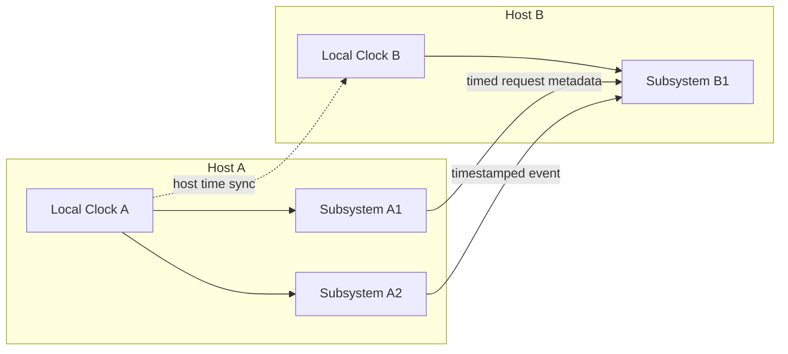

# Federation Time Model

R2Kernel treats timing as a host-level property that becomes visible to the
runtime. It does not create one artificial runtime-global clock object for every
subsystem.

When a robot spans multiple hosts, deterministic Control timing can no longer
assume that every subsystem reads the same local clock. R2Kernel uses a different
model.

- each host keeps running on its own local clock
- each subsystem keeps running at its own local execution rate
- host clocks are synchronized closely enough for cross-host interpretation
- runtime traffic carries timestamps or timing metadata when timing matters

This is not a model where one control backend drives the whole robot through one
shared master tick. It is a model where distributed hosts remain physically
separate while gaining a shared enough time basis for cross-host control and
observation.

## No Runtime-Global Master Clock

R2Kernel does not distribute one runtime-global clock object into every subsystem.
It also does not require one control backend to advance the whole system through
one shared spin or step loop.

Instead:

- each host continues to read its own local clock
- subsystems on that host interpret time against that host clock
- cross-host coordination depends on synchronized host clocks

So "shared time" in R2Kernel should not be read as "every subsystem reads one
literal global clock source." It means different hosts keep their clocks aligned
closely enough for timestamps and future execution targets to remain comparable.

## Local Clocks And Local Rates

Time comparability and execution frequency are different concepts.

- time comparability can be shared across hosts
- execution frequency is not forced to be identical across hosts or subsystems

A sensor subsystem, a motion component, a gateway, and an application can keep
their own local rates. Time sync only gives their timestamps and timed requests a
comparable basis when cross-host interpretation matters.

## Runtime Acceptance

The runtime does not assume that time sync is good just because a time-sync
process exists.

It needs evidence that timing is acceptable for the deployment mode. In a
production path this usually means host-level PTP or another product-approved
clock discipline. In a sandbox or VM smoke path, R2Kernel can use its logical
time-sync mode to estimate offset and uncertainty for diagnosable tests.

The important concept is layered acceptance.

- link-level lock is not the same as application-visible clock acceptance
- synchronized host clocks are used only where timed metadata needs cross-host interpretation
- timing-sensitive failures should be visible as runtime status, not hidden inside subsystem code

## Where Timing Information Appears

R2Kernel uses synchronized host time where timing matters.

- Event timestamps that need cross-host interpretation
- Control, Procedure, and Operation requests that carry timed execution metadata
- late-policy decisions for Control requests
- runtime status about host clock health and uncertainty

Subsystems do not need a runtime-global clock service object. They need
timestamps and timing metadata that the runtime can interpret consistently
across hosts when the deployment requires it.

## Related Pages

- [Federation and Host Control](federation-and-host-control.md)
- [Time Sync Operations](../operate/time-sync-operations.md)
- [Troubleshooting](../operate/troubleshooting.md)
