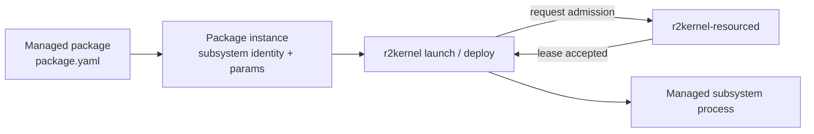
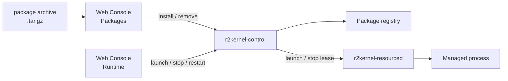

# Managed Packages and Runtime Instances

R2Kernel uses managed packages to make subsystem execution a runtime-owned
boundary, not only a user shell command.

A subsystem is the semantic runtime unit. A package is the deployable execution
unit for one subsystem implementation.

## Package Boundary

The package manifest declares the execution shape.

- entrypoint command, arguments, environment, and working directory
- allowed package instance parameters and defaults
- resource intent, such as CPU, network, CAN, serial, device, or frontend
  listener claims
- sandbox policy for brokered sockets and managed device FDs
- optional package-local spec roots for endpoint type validation
- optional static frontend assets for packages

`r2kernel-package` validates and builds the package directory. The launcher asks
`r2kernel-resourced` for admission before the process starts. Resource semantics
are described in [Resource Authority](resource-authority.md). This page focuses
on the package and managed-instance boundary.

During managed launch, R2Kernel injects runtime context into the process
environment. That includes the subsystem manifest path, package identity,
instance identity, runtime directories, launch parameters, bindings, the
runtime-wide contract policy, and any package-local spec roots.

Contract conformance policy is runtime-wide. Operators set
`contracts.policy` in `runtime/config.yaml`. Packages may provide local spec
roots, but they do not own the system-wide strictness policy.

## Package Instances

A package is reusable. A package instance is concrete.

Instance parameters specialize the launch without copying the package
directory.

- subsystem name
- runtime directory
- command arguments
- environment values
- bindings from required interfaces to provider interfaces
- frontend context values

For example, one manipulator component package can run as
`demo.left_manipulator` and `demo.right_manipulator`. Each instance has its own
resource lease, subsystem name, runtime state, and frontend context.

Installed packages are treated as read-only artifacts. When R2Kernel is installed
under `<prefix>`, package instance state defaults to
`<prefix>/var/run/packages/<uid>/<instance-id>`, where `<uid>` is the user
the resource broker runs the package as, instead of being written back into
the package directory. Stopping an instance keeps this directory, including
`logs/stdout.log` and `logs/stderr.log`; the next start of the same instance
ID uses it again. Uninstalling a package removes its installed files and its
registry entry but not its instances' runtime directories, which belong to
the package user; remove them as root when the instance ID is not used
again. `<prefix>/var/lib/packages/registry.json` is the package store's
committed record and stays, listing no packages, after the last package is
uninstalled. Uninstalling R2Kernel removes both with `<prefix>/var`.

Development and site-managed package trees can be added through
`packages.additional_paths`. They enter the same runtime launch and frontend
paths without being copied into `packages.install_dir`. R2Kernel treats those
directories as externally owned and therefore does not remove them from the
Packages page.

## Runtime Management

The Web Console exposes installed packages through two separate
responsibilities.

| Surface | Responsibility |
| --- | --- |
| Packages | install, remove, inspect package metadata, discover static UI |
| Runtime | launch, stop, restart, terminate, inspect lifecycle and bindings |

A package archive can be uploaded through the Packages page and installed into
the configured package directory. Runtime then launches one or more package
instances. Managed package launch still goes through `r2kernel-resourced`; the
control backend stores the package registry and lifecycle intent, not an
unmanaged process tree.

## Static Package Frontends

Any installed package can include a static frontend. The control backend serves
that UI under `/api/v1/packages/<package-id>/ui/` from the installed package payload.
Build package frontends with relative asset URLs so nested JavaScript, CSS, and
image requests remain under that package-scoped route. Do not compile an
unprefixed `/packages/...` public base into the bundle.

The frontend shares the Console/API origin and security policy. The package backend
does not need to open an arbitrary web listener just to provide a browser UI.

Instance-specific GUI communication is declared through `frontend.context`.
Runtime resolves the context for each package instance. Browser code should use
that resolved context instead of hardcoding backend ports.

The corresponding package backend should open declared frontend listeners through
the managed resource broker. That keeps the listener tied to the instance
resource lease and avoids unmanaged TCP servers inside packages.

## Related Pages

- [Resource Authority](resource-authority.md)
- [Subsystem Packages](../tutorials/advanced-subsystem-packages.md)
- [Web Console Manual](../operate/web-console-manual.md)
