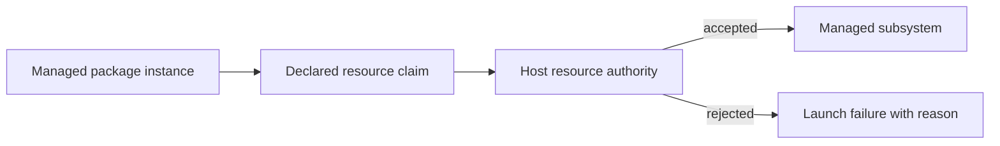

# Resource Authority

R2Kernel resource authority controls whether a managed subsystem may use a
host-local resource. Communication contracts describe data exchange. Resource
claims describe access to CPU, network, field interfaces, devices, and frontend
listeners.

## Authority Model

The runtime evaluates claims before the managed subsystem depends on them. An
accepted claim belongs to that package instance and is released when the
managed process scope ends.

## Resource Classes

| Resource | Public behavior |
| --- | --- |
| CPU | requests affinity, scheduling, and isolation policy supported by the host |
| NIC | admits IP networking through selected adapters, shared or exclusive among leases (a brokered UDP socket can still send through any adapter; see [Brokered Network Sandbox](../operate/resource-control.md#brokered-network-sandbox)) |
| Link layer | reserves an adapter for fieldbus gateways and, with a root approval, grants host-wide raw-network capabilities (see [Resource authority](../reference/resource-authority.md#approve-a-link-layer-capability-grant)) |
| CAN | admits use of CAN through selected SocketCAN interfaces (not confined to them; see [Brokered Network Sandbox](../operate/resource-control.md#brokered-network-sandbox)) |
| Serial and device nodes | requests access to selected host device outlets |
| Frontend listener | requests an instance-scoped listener for a package UI backend |

The launch result reports which guarantees were applied and whether the host
used a degraded fallback. Package code should not infer successful admission
only from process startup.

## Role Boundary

Gateway subsystems own hardware-facing claims. Component subsystems may request
compute resources and reach device-level hardware through gateway APIs.
Component, compound and app packages must explicitly declare
`resources.sandbox.network: brokered`, which permits direct creation of Unix
sockets only. Only gateways may select the `advisory` direct-network exception.
Platform-specific device behavior is implemented as a
component rather than by giving a compound direct gateway access. App
subsystems consume platform capabilities and use the managed
frontend path for package UI communication.

Static frontend assets are served by Control and require no package socket.
A package-specific frontend backend receives a Unix listener from the broker;
the broker retains the declared loopback TCP endpoint and relays connections.
This frontend grant does not grant a component general external networking.

This is an architectural rule, not a Linux claim that arbitrary unmanaged
programs cannot access the host. Product deployments must combine R2Kernel managed
launch with appropriate operating-system and appliance policy.

Process resource authority and Web/API authentication are separate boundaries.
If Console login or API authentication is disabled, clients admitted by that
listener's network policy can use its management functions, including local
application processes. Enable the corresponding authentication gates before
running packages that must not administer the host. A separate package account
protects Control's private files; it does not authenticate an open HTTP listener.

## Managed And Direct Execution

Managed package launch provides admission, ownership, cleanup, and runtime
inspection. Direct execution from a shell remains useful during development,
but it does not receive managed resource guarantees.

Product deployments should:

- run product subsystems as managed packages
- keep privileged helpers narrowly scoped
- restrict protected devices through host policy
- avoid broad user-group access to production hardware
- restrict unmanaged shell and root access according to the product threat model

## Observable Contract

Public documentation guarantees the following behavior.

- claims are validated before managed use
- conflicts are rejected with a diagnosable reason
- accepted ownership is tied to one managed instance
- process termination releases owned resources
- launch status reports applied and degraded guarantees

The mechanism used to create or transfer an accepted host handle is a private
runtime implementation detail.

## Related Pages

- [Communication Surfaces](communication-surfaces.md)
- [Managed Packages and Runtime Instances](managed-packages-and-app-runtime.md)
- [Resource Control](../operate/resource-control.md)
- [Resource Policy Tutorial](../tutorials/advanced-resource-policy.md)
