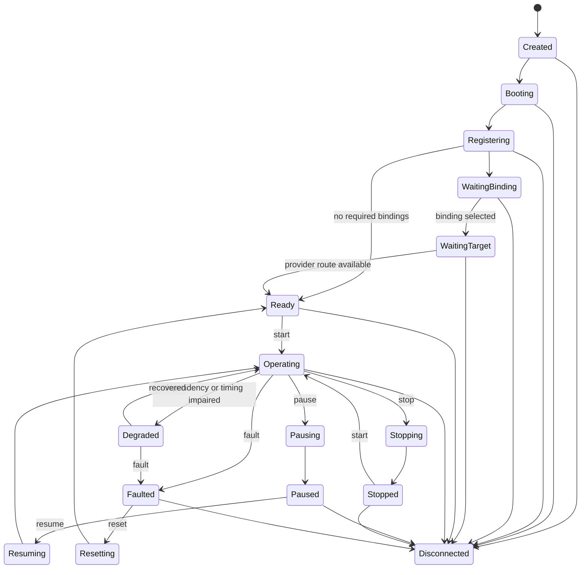

# Subsystem Lifecycle

R2Kernel treats a subsystem as the smallest runtime unit managed by the runtime
kernel. It is similar to an operating system process in that it has identity,
session state, resource ownership, and lifecycle transitions. It is different
from a generic process because lifecycle states carry robotics meaning.

The runtime owns the lifecycle state. User code does not set the state directly.
Operators and developers request transitions through the runtime, the runtime
validates the request, and the SDK calls the corresponding subsystem hook.

```text
operator or deployment request
  -> runtime transition validation
  -> subsystem lifecycle notification
  -> SDK hook
  -> heartbeat/status update
  -> Runtime Graph update
```

The main lifecycle shape is a finite-state machine.



The graph shows the normal control path. Runtime availability states such as
`WaitingBinding` and `WaitingTarget` can also return to `Ready` when deployment
wiring or provider routes become valid.

## Canonical States

| State | Meaning |
| --- | --- |
| `Created` | The subsystem object exists but has not registered. |
| `Booting` | The process is starting and constructing runtime state. |
| `Registering` | The SDK is registering identity, session, and notify channels. |
| `WaitingBinding` | Required binding information is absent or structurally invalid. |
| `WaitingTarget` | Binding exists, but the selected provider route is unavailable. |
| `Ready` | The subsystem is initialized and safe to start. |
| `Operating` | The subsystem is actively executing its runtime role. |
| `Pausing` | A pause request is being applied. |
| `Paused` | The process is alive, heartbeat continues, and outputs are held safe. |
| `Resuming` | A resume request is being applied. |
| `Stopping` | A runtime stop request is being applied. |
| `Stopped` | The subsystem is alive but no longer operating. |
| `Resetting` | A reset request is clearing fault/degraded state. |
| `Degraded` | The subsystem can still run, but a dependency, timing, or health condition is impaired. |
| `Faulted` | The subsystem must not continue normal operation until reset. |
| `Disconnected` | The runtime no longer has an active session for the subsystem. |

## Transition Requests

Lifecycle commands are requests, not state assignments.

```bash
r2kernel subsystem pause component.arm
r2kernel subsystem resume component.arm
r2kernel subsystem reset component.arm
r2kernel subsystem fault component.arm --reason "encoder timeout"
```

The runtime rejects invalid transitions. For example, `Faulted -> Operating`
must go through `reset -> Ready -> start`. `WaitingTarget -> resume` is not a
valid transition.

`reset` recovers a subsystem to `Ready`. It does not automatically restart
operation. Use `start` after reset when the subsystem should return to
`Operating`.

## SDK Hooks

Every subsystem still implements the required startup hooks.

- `on_initialize`
- `on_start`
- `on_terminate`
- `on_reset`

Runtime lifecycle requests use optional hooks.

- `on_pause`
- `on_resume`
- `on_stop`
- `on_fault`
- `on_degraded`
- `on_state_changed`

`pause` is a robotics-safe state. It does not suspend the operating-system
process. A mobile subsystem should command zero velocity or hold mode. A
manipulator subsystem should hold or safe-stop. An app subsystem should stop
issuing new decisions while keeping its session observable.

`stop` is also a cooperative lifecycle request. It asks the subsystem to enter a
safe stopped state while the process can remain alive and observable. A subsystem
must implement `on_pause`, `on_resume`, and `on_stop` to accept those requests.
The SDK default is conservative and rejects them rather than pretending an
unsafe pause or stop succeeded.

## Schema preparation before Ready

Initialization captures one effective schema context and contract inventory.
`on_initialize` declares/registers interfaces; afterward the SDK resolves their
structured payload graphs, including Control request/response and Event types,
and prepares their codecs before marking initialization successful and entering
`Ready`. Missing or malformed graphs fail initialization explicitly. Payload
handlers can use prepared plans after successful initialization, including in
`on_start`; they do not compile a graph on the first packet.

Selected standard and custom definitions preserve their canonical wire
encoding for the lifetime of the prepared context. Follow the public SDK
workspace ownership and thread-use contract when sharing typed codecs.

Changing schema files does not alter a running subsystem's snapshot. Explicitly
stop active dispatch, finish in-flight calls and reinitialize to capture a new
context and refresh advertised codec fingerprints/routes. Reinitialization is
rejected while Control transactions or active dispatch still own the old
context. A normal lifecycle `reset` clears operational fault state; it does not
implicitly reread schema files. This keeps a subsystem's interpretation stable
through `Ready`, `Operating`, pause/resume and fault recovery.

See [Typed Payload and Codec Guide](../api/typed-payload-and-codec.md) for native
views, borrowed payload lifetime and the generic codec's fresh lookup
behavior. Successful preparation says the graphs are usable; actual transport
rate and end-to-end completion still require measurement.

## Managed Process Actions

Runtime lifecycle and OS process control are separate.

| Action | Effect |
| --- | --- |
| Lifecycle `stop` | Calls the subsystem hook and keeps the process under runtime observation. |
| Process `terminate` | Stops the managed resource lease, sends `SIGTERM`, then escalates to `SIGKILL` if the process scope does not exit in the grace window. |
| Process `kill` | Immediately sends `SIGKILL` to the managed process scope. |

Process actions only work for managed subsystem packages that have a resource
lease. Direct-run subsystem processes can still receive lifecycle requests, but
the runtime does not arbitrarily kill unmanaged shell, IDE, or debugger
processes.

## Session State Is Separate

Lifecycle state is not the same as session liveness.

| Dimension | Examples |
| --- | --- |
| Session | active, stale, dead |
| Lifecycle | Ready, Operating, Paused, Faulted |
| Binding | bound, waiting binding, waiting target |
| Ownership | managed, unmanaged |

This separation matters during development. A direct-run subsystem can be
`Operating` while unmanaged by the launcher. A managed subsystem can be `Paused`
while its resource lease remains active. A stale session can be replaced without
silently stealing the identity of a live subsystem.

## Related Pages

- [Subsystem Binding Model](../concepts/subsystem-binding-model.md)
- [Communication Surfaces](communication-surfaces.md)
- [Managed Packages and Runtime Instances](managed-packages-and-app-runtime.md)

## Core startup ordering

The installed Control service uses systemd notification readiness. Dependent
services ordered after it wait until the HTTP, local management and UDP
listeners and required communication workers are ready. Control has no
separate federation status listener: peers exchange status through the
authenticated Host API. The HTTP readiness
endpoint uses the same contract and exposes individual listener flags. CLI
management commands use the configured local Unix socket, with one overall
request deadline and bounded responses. The local Unix socket serves at most 64
requests at once and at most 32 from one local user (UID); requests share a
64 MiB request-byte budget, of which one local user may hold at most 16 MiB,
with at most 4 MiB per request. A request whose user would pass its 16 MiB
share fails at once; a request within its share waits for bytes other users
hold, but only until its 2 s request deadline. A connection over a connection
or byte limit, a request over 4 MiB, a request over its user's share and a
request not completely received within its deadline each receive an explicit
JSON error (`status: error`) and are closed. Admission refusals are logged at
most once per 5 s per reason. Requests that fail on the socket itself (for
example a request not received within its deadline, or a reply the client does
not take), failed Event resource operations of subsystem requests, and failed
notification deliveries to subsystems are each logged at most once per 5 s,
with the number of failures since the previous line. A refusal from inside an
Event resource operation counts as a failed Event resource operation: a
registration, status update, or Event publish or subscribe request that
Control refuses there (for example a registration of a
name that another active session holds, or a registration refused with a
request to retry) is answered with its error and counted in that line. Other
refused requests are answered with their error and are not logged; a cleanup
request that Control declines is answered `cleaned: false` with a `reason`,
and a process request (terminate or kill) that Control refuses is answered
with `ok: false`, and neither is logged. Two
registration refusals that ask for a retry carry a stable `reason` next to
`status: error` and `error`: `registration_gate_busy` (replacing the expired
registration waits for other Event resource operations that did not finish
within the 1.5 s reply budget) and `registration_cleanup_pending` (the cleanup
of the expired registration did not finish within that budget and continues).
No other registration reply carries `reason`; self-binding refusals carry their
own `reason` codes. Safe status reads may
retry a missing startup socket before sending; requests are never replayed after an ambiguous
send or response failure. UDP management remains available to clients that
use it explicitly.
