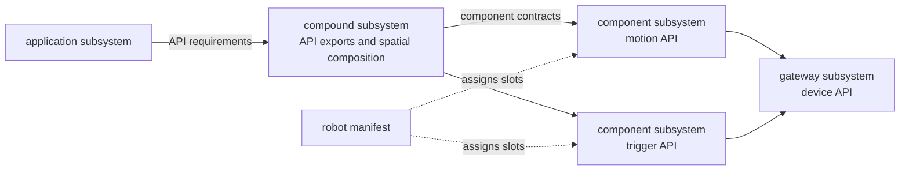

# Robot, Application, And Deployment

R2Kernel treats a robot as one software-defined composition.

```text
robot = platform + application + deployment
platform = what the robot is and what it can provide
application = what the robot should do
deployment = what runs, where it runs, and how it connects
```

This keeps a platform reusable. One platform can run different applications,
and one application can target any platform whose exported APIs satisfy the app
requirements. Platform compatibility labels can narrow that match when an app is
written for a specific robot family, but API requirements are the main
compatibility surface.

## Platform

A platform is the reusable robot body and its API surface.

It is not one launch script and not one process. It is a declaration of the
robot slots, robot structure, and exported APIs that applications can use.

Platform slots are filled by subsystem instances.

| Slot family | Typical provider | Purpose |
| --- | --- | --- |
| gateway | `role: gateway` subsystem | device boundary for physical hardware or simulator-backed devices |
| component | `role: component` subsystem | reusable robotics function such as motion, perception, planning, or safety |
| compound | `role: compound` subsystem | physical composition, static mounts, and selected API exports |

Device-level hardware is connected only through gateway subsystems. Servo
drivers, fieldbus devices, sensors, cameras, and similar physical outlets are
treated as hardware behind the gateway device boundary. Component subsystems
consume gateway API contracts instead of opening those devices directly.

## Application

An application is the selected behavior for the robot.

An app-role subsystem requires the public `api.*` contracts it uses. For example,
the cleaner app requires `api.motion.articulated.trajectory.v1`; deployment
binds that requirement to the cleaner compound's `articulated_trajectory` export.
The app uses a logical requirement name while deployment selects the provider.

The application process still appears as a subsystem instance at runtime. The
top-level `application` field in a deployment selects which app-role subsystem
is checked against the platform.

The platform-facing boundary is the compound's exported API contracts. Building
atomic skills from those APIs, selecting tasks, and composing rule-based or
dynamic plans are application responsibilities. An application may use an agent,
a neuro-symbolic behavior model, or deterministic automation rules; none is a
required kernel behavior model. R2Kernel manages the app's declared interfaces,
execution, and lifecycle without interpreting its task planner. Applications
must still honor the contracts' timing, cancellation, error, and safety semantics;
matching endpoint names alone does not establish behavioral compatibility.

## Deployment

A deployment makes the platform and application concrete.

It chooses package instances, launch mode, host placement, runtime parameters,
slot assignments, and bindings between required and provided interfaces.

The cleaner deployments select the same platform and change the application.
This binding excerpt shows the application boundary; the complete deployment
also declares the instances, robot slots, and component-to-gateway bindings.

```yaml
bindings:
  app.cleaner.radar.manipulation:
    to: compound.cleaner.articulated_trajectory
  compound.cleaner.manipulation:
    to: component.manipulation.manipulator
```

`managed` means R2Kernel can launch the instance. `external` means the instance is
started by a developer, debugger, IDE, simulator, or another process supervisor.
`federated` reserves an instance identity for a remote host.

## Subsystem Roles

After the platform, application, and deployment split is clear, R2Kernel names the
executable pieces inside the robot. Those pieces are subsystems.

Every executable piece uses a `r2kernel.subsystem` manifest and declares one role.

| Role | Meaning |
| --- | --- |
| `gateway` | device boundary for physical hardware or simulator-backed devices |
| `component` | reusable robotics function such as motion, perception, planning, or safety |
| `compound` | declarative composition, static spatial mounts, and selected API exports |
| `app` | top-level app subsystem that represents the selected robot task |

A subsystem role is not the same thing as a spec family. For example,
`role: component` is a runtime role, while `component.*` is a public
compatibility contract namespace for component-role subsystems.

## Exported API Surface

A declarative compound requires component contracts and selects their
`conformance_apis` for its app-facing surface. An export keeps the API contract
ID and gives it a platform-local alias.

```yaml
requires:
  incinerator:
    contract: component.trigger_actuator.v1
    cardinality: one
    required: true
exports:
  trash_disposal:
    contract: api.actuation.trigger.v1
    from:
      requirement: incinerator
```

The cleaner's `trash_disposal` alias selects the incinerator component's trigger
API. The component owns the device meaning and output handling. The compound
declares the connection; it does not implement a second trigger endpoint or
translate requests. Task sequencing, retries, and collection order belong to
the app, while physical mounts remain in the compound.

For the manifest fields, see
[Compound API Exports](../spec/subsystem-binding-manifests.md#compound-api-exports).

## Deployment Levels

Not every deployment manifest is a full robot application. R2Kernel accepts three
useful levels.

| Level | Fields | Purpose |
| --- | --- | --- |
| Subsystem composition | `instances`, `bindings` | Launch or validate a partial subsystem set. There is no platform slot validation. |
| Platform bring-up | `robot`, `instances`, `bindings` | Start and validate an app-less platform. Slots, public contracts, and compound exports are checked. |
| Full robot application | `robot`, `application`, `instances`, `bindings` | Run one selected application on one compatible platform. App API requirements are checked against the selected interfaces or exports and optional platform compatibility labels. |

Tutorial stage deployments can run without `robot` because they are partial
composition stages. Platform bring-up adds `robot` without `application` so it
can check the app-less platform. Final application deployments include both.

## Diagram Model

The same manifests can be rendered as a static or live graph.



Static diagrams use robot, subsystem, and deployment manifests. Runtime diagrams
add live session, route, lifecycle, and health status from the control backend.

## Validation

Validation is the runtime-kernel check that the platform, application, and
deployment composition is structurally coherent before it is treated as a
robot. Conceptually, validation checks that:

- robot manifest and app-role subsystem manifest exist
- application-required platform compatibility labels are provided by the platform when label constraints are declared
- application-required APIs have compatible provided interfaces or compound exports
- required robot slots are filled by subsystem instances
- managed functional component and gateway subsystems are attached to robot slots;
  app and composition-only compound instances are not
- instance roles match their robot slots
- slot contracts are public R2Kernel specs provided by the assigned instance interfaces
- compound exports select conformance APIs of their required components
- required subsystem bindings exist and contracts match

The command-level workflow lives in the
[Robot/Application/Deployment Manifests](../spec/robot-application-deployment-manifests.md)
reference.

## Related Pages

- [Subsystem Binding Model](subsystem-binding-model.md)
- [Robot/Application/Deployment Manifests](../spec/robot-application-deployment-manifests.md)
- [Define Platform](../tutorials/define-platform.md)
