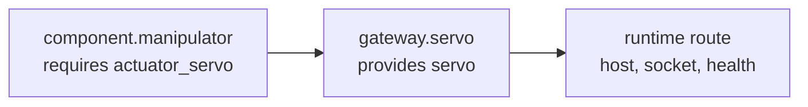

# Subsystem Binding Model

R2Kernel separates interface declaration from deployment wiring.

A subsystem binary should not need to know which concrete gateway, component,
compound provider, simulator, or remote instance it will use in a final robot
deployment.

The base model has three layers.

```text
subsystem manifest = role plus what this subsystem provides and requires
deployment manifest = which provider instance satisfies each requirement
runtime registry = where the selected provider is currently reachable
```

Robot applications add two composition manifests above this base.

```text
robot manifest = functional gateway and component slots plus platform composition
app-role subsystem manifest = top-level application requirements
deployment manifest = robot + application + package instances + bindings
```

## Declaration Versus Binding

The subsystem manifest answers this question.

```text
What does this subsystem provide, and what does it require?
```

The deployment manifest answers this question.

```text
Which concrete provider satisfies each requirement in this deployment?
```

This distinction lets the same component binary bind to a real gateway, a
simulator gateway, a test stub, or a remote provider without changing source
code.

## Provides And Requires

```yaml
kind: r2kernel.subsystem
version: 1

subsystem:
  name: component.manipulator
  role: component

requires:
  actuator_servo:
    contract: api.actuator.servo.v1
    cardinality: one
    required: true

provides:
  manipulator:
    contract: component.manipulator.v1
```

`provides` names interfaces implemented by this subsystem. `requires` names
logical dependencies that the subsystem code will use.

The names under `requires` are not provider identities. They are local logical
names. Deployment supplies the provider identity later.

## Deployment Binding

A deployment chooses the provider instance for each requirement.

```yaml
kind: r2kernel.deployment
version: 1

instances:
  component.manipulator:
    manifest: ./component.manipulator/subsystem.yaml
  gateway.servo:
    manifest: ./gateway.servo/subsystem.yaml

bindings:
  component.manipulator.actuator_servo:
    to: gateway.servo.servo
```

The binding key is the consumer requirement.

```text
<consumer-subsystem>.<required-interface>
```

The binding target is the provider interface.

```text
<provider-subsystem>.<provided-interface>
```

The deployment loader validates that both manifests exist, both interfaces
exist, and their contracts match.

## Multiple Instances

Reusable packages can be instantiated more than once. In that case the
deployment names concrete runtime identities while pointing them at the same
package or subsystem manifest.

```yaml
kind: r2kernel.deployment
version: 1

instances:
  component.left_manipulator:
    package: ./packages/manipulator
    params:
      robot_id: left
  component.right_manipulator:
    package: ./packages/manipulator
    params:
      robot_id: right
  gateway.servo:
    manifest: ./gateway.servo/subsystem.yaml

bindings:
  component.left_manipulator.actuator_servo:
    to: gateway.servo.servo
  component.right_manipulator.actuator_servo:
    to: gateway.servo.servo
```

The package can be reusable while each runtime instance keeps its own subsystem
identity, parameters, state directory, resource lease, and lifecycle state.
The two requirements can also select the same Gateway provider interface:
each component has its own 1:1 Control session, while the Gateway exposes one
contract and one handler for that endpoint. A source subsystem must not bind
two requirements to that same Control provider as separate groups in this
release.

## Public And Internal Contracts

Subsystem public interfaces are the standardization boundary. Public contracts
must resolve to R2Kernel specs such as `api.actuator.servo.v1`
or `component.mobile_base.v1`.

New app-facing requirements use `api.*` contracts and can bind to a compound's
exported API aliases. An alias preserves the selected component API contract;
it is not a new endpoint implementation.

Private tutorial wiring can be marked explicitly.

```yaml
provides:
  procedure:
    contract: tutorial.transport.procedure.v1
    visibility: internal
```

`visibility: internal` means the interface is not claiming product-level
compatibility. Robot slots and compound exports must bind through
public R2Kernel spec interfaces.

Endpoint names are not runtime data. R2Kernel validates endpoint registration as a
closed-world contract surface, so a subsystem cannot create a new Event topic or
Procedure name for every task, object, or operation. Use fixed contract
endpoints and carry changing identifiers inside payload fields.

## Runtime Availability

Binding validation is structural. It answers this question.

```text
Is the deployment wired correctly?
```

Runtime route resolution answers a different question.

```text
Is the selected provider currently running and reachable?
```

Those states are intentionally separate. A deployment can be structurally valid
while a provider process is starting, restarting, waiting on another subsystem,
or temporarily disconnected.

| State | Meaning |
| --- | --- |
| `INVALID_CONFIG` | Manifest or binding structure is invalid |
| `WAITING_BINDING` | Binding is missing or not structurally usable |
| `WAITING_TARGET` | Binding is valid but the provider route is not available yet |
| `BOUND` | Binding target is known and route resolution succeeded |
| `READY` | Required bindings and local registrations are ready |
| `DEGRADED` | A previously available runtime binding was lost |

## Runtime Binding Sources

Control records where each live runtime binding came from and reports it as the
row's `origin`:

| Origin | Created by |
| --- | --- |
| `operator` | an operator or manager binding (`r2kernel subsystem bind`, Runtime Graph, or `POST /api/v1/control/bindings`) |
| `launch_intent` | `--bind` on a managed launch, or `bindings` in a REST package start, applied when that instance's own process registers |
| `self` | a subsystem binding its own requirement through the SDK (`bind_requirement`) |
| `peer` | a binding row received from a federation peer |

An operator binding takes precedence. Launch bindings and self-bindings pass the
same validation as an operator binding. A self-binding targets only local
providers and is removed when its source registration ends or re-registers;
see [Subsystem SDK Guide](../api/subsystem-sdk-api.md#binding-own-requirements).
Bindings are a registry and routing contract; local Control access is bounded by
caller authentication and the runtime IPC group, not by bindings.

## What Goes Where

| Layer | Owns |
| --- | --- |
| Subsystem code | logical requirement names such as `actuator_servo` |
| Subsystem manifest | role, `provides`, `requires`, compound `exports`, interface contracts, and concrete spatial ports or mounts |
| Component spec | public API conformance plus required spatial participation and port semantics |
| Robot manifest | functional gateway and component slots plus platform composition |
| App-role subsystem manifest | top-level app subsystem and required platform labels and API contracts |
| Deployment manifest | platform, application, package instances, selected slots, and selected provider instance for each requirement |
| Runtime registry | current route, endpoint, host, socket, lifecycle, and health state |
| Package manifest | reusable executable launch, parameters, environment, resources, and app assets |

## Diagram Model

The same data can be rendered at three levels.



- Static interface diagrams use subsystem manifests.
- Deployment wiring diagrams add robot, app-role subsystem, and deployment manifests.
- Runtime diagrams add live route, binding, lifecycle, and health state from the control backend.

## Related Pages

- [Robot, Application, And Deployment](robot-application-deployment-model.md)
- [Subsystems, Roles, And Interfaces](../architecture/subsystems-and-contracts.md)
- [Spatial Model And Frame Graph](spatial-model.md)
- [Subsystem Binding Manifests](../spec/subsystem-binding-manifests.md)
- [Add Component Subsystems](../tutorials/add-component-subsystems.md)
