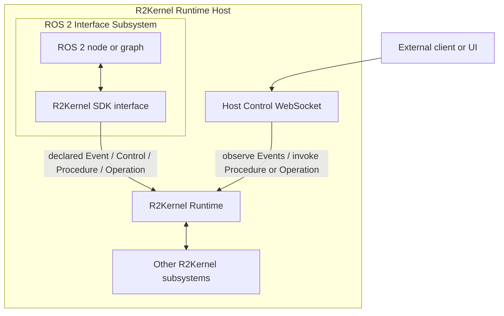

# Using R2Kernel With ROS 2

R2Kernel does not require a robot system to remove ROS 2.

The supported boundary is explicit. Either expose ROS 2 through a
R2Kernel-managed interface subsystem, or keep the client outside the native
runtime and use Host Control WebSocket.

The `ROS 2 Interface Subsystem` is ordinary subsystem code that uses the R2Kernel
SDK and a ROS 2 client library in the same Linux process boundary. It declares
the R2Kernel Spec surfaces exposed to the rest of the robot system and translates
between those surfaces and the local ROS 2 graph.

The WebSocket path is different. It is for browser, cloud, desktop, or
non-R2Kernel clients that should observe or control a R2Kernel host without joining
native runtime transport.

## Different Architectural Layers

ROS 2 is commonly used as a node graph and integration ecosystem. R2Kernel is an
execution runtime boundary for software-defined robot systems.

| ROS 2 concept | R2Kernel concept |
| --- | --- |
| Node graph | Subsystem runtime |
| Topic/service/action graph | Declared Event / Control / Procedure / Operation surfaces |
| DDS/RMW transport selection | Runtime-owned local transport and federation |
| Launch files and node composition | Managed packages and resource leases |
| Package ecosystem | Contracted subsystem execution boundary |

The comparison is not adversarial. A system can use ROS 2 inside a subsystem
while using R2Kernel to govern how that subsystem is launched, observed,
timed, federated, and exposed to the rest of the robot system.

## Common Patterns

**ROS 2 inside a device gateway**  
A sensor or actuator stack can remain ROS 2 internally. A ROS 2 interface
subsystem publishes the product-facing R2Kernel state and control contract.

**R2Kernel wrapper around an existing ROS 2 application**
An existing ROS 2 graph can be treated as one subsystem and launched through a
managed package with CPU, NIC, CAN, or serial claims.

**ROS 2 simulation interface**  
A simulator or ROS 2 simulation stack can expose selected state through a
R2Kernel interface subsystem so the same downstream subsystem contracts are used
in simulation and hardware deployment.

**Runtime boundary for product integration**  
ROS 2 remains useful inside the subsystem. R2Kernel becomes the layer that
coordinates multi-host federation, timing acceptance, resource admission, and
external operations surfaces.

**External observation and control**  
A non-R2Kernel tool can use Host Control WebSocket to observe Events and invoke
Procedure or Operation calls. This is the correct path for browser frontends,
cloud tools, Windows/macOS applications, and other clients that should stay
outside native runtime transport.

## Boundary Rule

Keep ROS 2 graph details inside the subsystem boundary when the rest of the
robot does not need to know them.

Expose R2Kernel contracts at the boundary when another subsystem, host, UI, or
product service needs stable access.

When ROS 2 code must participate in native R2Kernel timing, resource, and
federation semantics, implement it as a ROS 2 interface subsystem. When the
client is external to the runtime, use Host Control WebSocket.

This keeps local experimentation and existing ROS 2 packages usable while giving
the deployed robot a clearer runtime contract.

## Scope

This page is about integration boundaries. Communication measurement and
comparison methodology belong to the Performance section.
