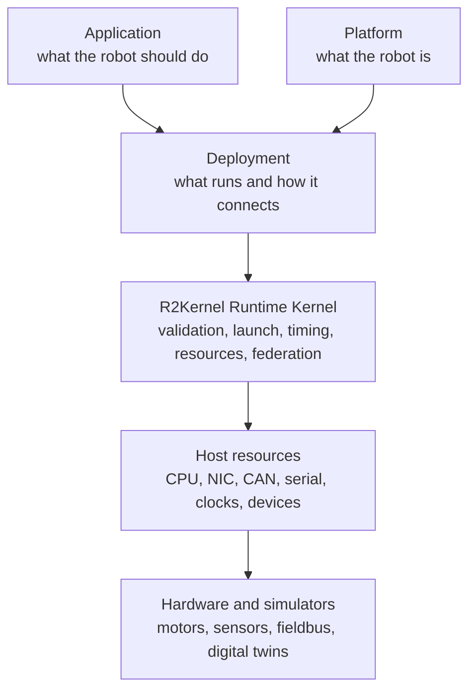
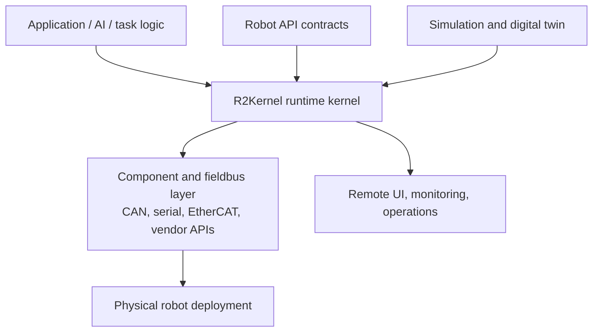

# What Is R2Kernel

R2Kernel™ is a project of Librerobotics™. It is a runtime kernel for defining, running, and operating
software-defined robots.

Librerobotics is led by its Founder & Captain, Justin H. Kang. Project identity
and leadership do not replace the rights-holder and license notices supplied
with each release. See [Distribution And Licensing](reference/distribution-and-licensing.md).

In R2Kernel, a robot is not one process, one controller, or one launch script. It
is a declared composition of a platform, an application, and a deployment.

  Robot
  =
  Platform
  +
  Application
  +
  Deployment

  

    
Term

    
First meaning

  

  

    
Platform

    
what the robot is and what it can provide

  

  

    
Application

    
what the robot should do

  

  

    
Deployment

    
which concrete packages run, where they run, and how they are connected

  

The platform is the reusable robot body. It describes what the robot can
provide to an application, such as motion, sensing, manipulation, or
diagnostics. It does not describe one temporary launch script or one lab
machine.

The application is the selected behavior for that platform. It describes what
the robot should do, such as teleoperation, inspection, cleaning, or task
execution. It should rely on what the platform provides instead of hardcoding
one hardware layout.

The deployment makes that pair concrete. It selects the packages, hosts,
hardware or simulator targets, runtime parameters, and UI surfaces that will be
used for one running robot composition.

The runtime kernel validates and operates this composition. It keeps robot
application logic separate from host resources such as network adapters,
clocks, device files, process ownership, and physical interfaces.

Each R2Kernel deployment models one robot at a time. That robot may span multiple
hosts, use simulation or real hardware, and expose remote UI or diagnostics.
Fleets and swarms sit above this boundary. R2Kernel focuses on the runtime
definition of each robot inside them.

After that composition is clear, R2Kernel introduces the executable pieces inside
it. Those pieces are subsystems. Some run application behavior, some implement
reusable robotics functions, and some connect the robot to physical hardware or
simulator-backed devices. The platform says what kind of robot those pieces
form. The deployment selects the
concrete packages and connects them.

## The Problem R2Kernel Solves

This matters because practical robots are compound systems. Even one robot can
contain the following.

- one top-level application controller
- motion, perception, planning, safety, and diagnostics controllers
- component subsystems and physical or simulator-backed gateway subsystems
- additional sensors and hardware adapters
- external planners, UI clients, and diagnostics tools
- multiple hosts with different clocks, NICs, and physical interfaces
- simulation, test, and real-hardware deployments that should share contracts

Without a runtime-kernel layer, each expansion tends to create its own socket
topology, custom message shape, launch rule, resource permission model, robot
configuration file, and timing assumption. The result is a robot that can work
in one lab setup, but is hard to define, reproduce, inspect, or deploy as a
product.

This usually appears as duplicated launch scripts, transport-specific
application code, unmanaged CAN or serial ownership, unclear timing assumptions,
and separate simulation and real-hardware wiring. The robot may still run, but
its operational behavior is not represented as one coherent robot definition.

R2Kernel is designed for the opposite direction. Subsystems declare what they are
and what they need. The platform declares what the robot can provide. The
deployment declares how the application is mapped onto that platform. The
runtime kernel owns how the resulting composition is connected, launched,
observed, timed, and admitted to host resources.

A conventional robotics stack often treats execution as an unmanaged collection
of processes. R2Kernel treats execution as a runtime-managed robot.

| Unmanaged robotics stack | R2Kernel-managed runtime |
|---|---|
| Launch scripts define behavior implicitly | Robot deployment manifests define composition explicitly |
| Processes open sockets and components directly | Subsystems request admitted resources through the runtime |
| Timing assumptions live in code | Timing API contracts are declared and inspected |
| Simulation and hardware paths drift apart | Both can share the same contract model |
| Observability is added after deployment | Runtime status is part of the robot definition |

## Software-Defined Robotics

Software-defined robotics means robot behavior is not only embedded in one
closed controller or one physical wiring layout. It is expressed through a
platform definition, application requirements, executable subsystem
contracts, runtime composition, and deployment policy.

In this context, "software-defined" does not merely mean configurable software.
It means that deployment topology, hardware access, timing assumptions, and
simulation-to-real boundaries are represented as runtime-visible contracts
rather than hidden integration code.

For R2Kernel, that means the following.

- the robot surface is declared at the platform level through slots and
  compound API exports
- application requirements are checked against the platform's exported API
  contracts
- subsystem capability is declared through role, interface, and spec contracts
- communication semantics stay stable even when transport realization changes
- applications can move across compatible platforms without hardcoding one
  vendor controller, component subsystem, or gateway identity
- subsystems can move from local test to multi-host deployment without changing
  the robot model
- simulation bridges, gateway subsystems, and physical controllers can participate
  in the same runtime structure
- launch and resource admission are explicit parts of the robot system, not
  afterthought shell scripts

## Where R2Kernel Sits

R2Kernel is not the AI stack, simulator, fieldbus driver, or Linux kernel. It is
the runtime-kernel layer that turns application, platform, subsystem, and host
resources into one operable robot composition.

Message transports move data between subsystems. R2Kernel also decides which
subsystems are admitted, which resources they may use, how their declared
surfaces are validated, how timing expectations are interpreted, and how runtime
state is observed.

This is why R2Kernel includes more than communication APIs. It also includes the
control backend, managed packages, resource authority, time-sync acceptance,
runtime status, WebSocket observation, and release provenance.

## What R2Kernel Provides

R2Kernel groups its responsibilities into a few operational domains.

### Robot Composition

Robot composition is the model that separates robot capability, application
intent, and concrete deployment wiring.

- robot manifests for robot parts, control slots, and gateway slots
- component spatial conformance and compound mounts for the live frame graph
- app-role subsystem manifests for top-level robot API requirements
- deployment manifests for concrete subsystem instances, slots, launch modes,
  hosts, and bindings
- static and runtime graph views of how the robot is connected

### Runtime Authority

Runtime authority is the part of R2Kernel that turns declared subsystems into
managed execution units. It is responsible for validating, launching, observing,
and admitting subsystem resource claims.

- subsystem execution through explicit `gateway`, `component`, `compound`, and
  `app` roles
- managed package validation and launch
- resource admission for CPU cores, NICs, CAN interfaces, serial ports, and
  Linux device nodes
- brokered resource handles for managed processes

### Communication

R2Kernel separates communication by intent, not only by transport. High-rate data
streams, timing-aware control paths, bounded procedures, long-running
operations, and browser observation do not belong to the same operational
category.

- host-local Event paths for high-rate data
- Control, Procedure, and Operation paths for explicit control semantics
- cross-host Event federation through control-owned transport
- WebSocket facade for browser-facing clients outside the native runtime path

### Contracts

- canonical message, API contract, and component specs
- component bundles for component-role subsystem compatibility
- robot declarations that compose gateway, component, and compound surfaces
- runtime validation of declared subsystem surfaces
- language SDKs that share the same contract model

### Timing

- host-level time-sync observation and management
- accepted timing API contracts for one-way cross-host interpretation
- timed request metadata for coordinated control paths

### Operations

- runtime status and diagnostics
- release and install provenance
- deployment checks with declared profiles and measured evidence

For example, a pick-and-place application may target a platform that provides a
manipulation capability and a motion control component. The application does not
need to hardcode the vendor controller or simulator identity. The deployment
selects concrete subsystem instances. The runtime validates and operates that
composition.

## What R2Kernel Is Not

R2Kernel intentionally stays below a full operating system and above a loose
library model.

- It does not replace Linux.
- It does not require removing ROS 2 or other robotics tools.
- It does not force every deployment to be multi-host.
- It does not model robot fleets or swarms as the primary unit.
- It does not make every subsystem run on one global clock tick.
- It does not control unmanaged processes that intentionally bypass the runtime.

Product deployments can make R2Kernel the required execution path for robot
subsystems, but root access, kernel policy, and appliance hardening remain host
or product responsibilities.

## Next Pages

For bug reports, feature requests, usage questions, and documentation feedback,
use [R2Kernel Issues](https://github.com/r2kernel/r2kernel/issues). Include the
release version and affected component so feedback can be tracked in one place.

- fast conceptual onboarding - [R2Kernel in 3 Minutes](overview/r2kernel-in-3-minutes.md)
- install and first run - [Installation](getting-started/installation.md) and [Quickstart](getting-started/quickstart.md)
- current support and limitations - [Support and Compatibility](reference/support-and-compatibility.md)
- version changes and release downloads - [R2Kernel Releases](https://github.com/r2kernel/r2kernel/releases)
- robot and runtime-kernel concepts - [Concepts](concepts/concepts-overview.md)
- host operation and validation - [Operate](operate/operator-overview.md)
- SDK and tutorial workflows - [Develop](develop/developer-guide.md)
- protocol and spec lookup - [Reference](reference/reference-overview.md)
