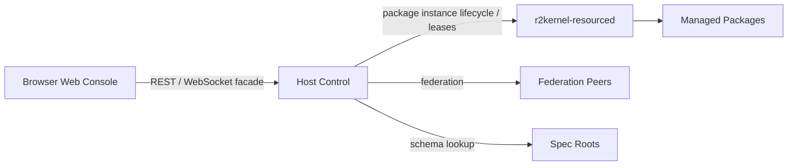

# Web Console Manual

The R2Kernel™ Web Console is the browser-facing operations surface for one host
control backend. It shows runtime status, resources, packages, specs, diagnostics,
and configuration from the same HTTP origin as the REST and WebSocket APIs.

The Console is not the native transport hot path. Browser traffic enters through
the control backend facade, while native Event, Control, Procedure, and
Operation paths remain inside the R2Kernel runtime boundary.



## Access

The bundled Console is available when the runtime configuration uses
`control.frontend.mode=bundled`, which is the default installed mode. Frontend
policy is part of the host runtime configuration; see
[Runtime Configuration](runtime-configuration.md) before replacing or disabling
the system frontend.

Open the configured Console address. A new installation starts with HTTP on
loopback port `18080`.

```text
http://127.0.0.1:18080/
```

Settings → Security → Console connection selects the protocol and its port.
HTTPS defaults to `18443` when enabled. Missing Console port values use the
defaults. Explicitly configured ports remain unchanged, including
`control.ui_port: 0` API sharing.

The independent product API origin defaults to `http://127.0.0.1:8001` and serves.

- REST APIs under `/api/v1/control/*`
- stable product-facing REST APIs under `/api/v1/*`
- WebSocket facade endpoints under `/api/v1/ws/events` and `/api/v1/ws/control`
- static package frontends under `/api/v1/packages/<package-id>/ui/`

When security is enabled, browser users should log in through the Web session.
API keys are for external REST/WebSocket clients, automation, and monitoring.
See [Web and API Security](web-and-api-security.md).

Use [Product Frontend Modes](product-frontend-modes.md) when a product should
serve its own static SPA from the control backend or run Host Control APIs
without serving the bundled Console. Managed package frontends are separate and
continue to use `/api/v1/packages/<package-id>/ui/`.

## Workspace

The Console uses a desktop-style workspace.

- open tools from the left launcher
- keep multiple tools open at the same time
- move, resize, minimize, maximize, snap, restore, and close windows
- double-click a title bar to maximize or restore
- use density control when screen space is limited

Use this model when comparing host status with specs, watching Console traffic
while inspecting Resources, or managing Packages while Overview remains visible.

## Page Map

| Page | Use |
| --- | --- |
| Overview | host identity, readiness, federation peers, and connection surfaces |
| Resources | host inventory, resource authority, and active leases |
| Runtime | registered subsystems, interface graph, bindings, and managed instance lifecycle |
| Specs | runtime-visible spec dictionary |
| Packages | package install/removal, resource claims, and static package UI links |
| Messages | browser-safe Event, Procedure, and Operation testing |
| Terminal | operating-system login in the right-hand workspace |
| Settings | categorized runtime configuration, security, Terminal setup, and apply actions |

## Overview

Overview is the first page to check on a host.

It answers these questions.

- is the host ready?
- is time sync accepted for the current workload?
- is the resource authority online?
- which peers are visible?
- which connection surfaces are exposed?

Important distinction.

- `Assigned address` is the host identity or reachable federation address.
- `API host` is the local bind address for product REST and WebSocket endpoints.
- Console HTTP uses `control.ui_host` (the API host when empty) and
  `control.ui_port`; native HTTPS uses `control.management_https`.

Use **Open Console** on a peer when an issue must be inspected from that host's
own control backend.

## Resources

Resources combines live host telemetry with resource-authority state.

Use it to inspect.

- CPU and memory usage
- NIC inventory, state, speed, and counters when the host reports them
- resource-service health
- active managed leases
- CPU, NIC, CAN, serial, device-node, sandbox, and limit claims

`Active leases` are allocations owned by managed package or launcher processes. If
the resource service is unavailable, the Console may still show basic host
usage, but managed resource-control guarantees are not active.

## Runtime

Runtime shows the native R2Kernel runtime from the control backend viewpoint. It
can be viewed as a detailed list or as a graph. The graph places communication
and spatial composition on the same subsystem cards. Circular ports show
required and provided interfaces under **System surface**. Diamond ports show
physical attachment points and provided frames under **Spatial surface**.
Component and compound cards use the same spatial surface rows on the right.
This placement distinguishes public spatial ports from communication
requirements. A compound adds an **Internal composition** section for its mount
relationships. Dashed lines connect component or nested compound ports to those
compound-owned mounts. A provided frame can show its source, such as
`body ← mobility.body`, inline rather than as a second topology line.

Use it to inspect.

- registered subsystems and lifecycle state
- launch, stop, or restart managed package subsystem instances
- Event publish and subscribe surfaces
- federation-visible Event streams
- provided and required interfaces from subsystem manifests
- deployment bindings between required and provided interfaces
- runtime bindings set interactively during development or repair
- Control endpoints
- Procedure endpoints
- Operation endpoints
- spec references attached to contracts

Control is separate from Procedure and Operation.

- Control is periodic request/response exchange with period and deadline intent.
- Procedure is bounded synchronous request/response.
- Operation is asynchronous execution with goal, feedback, state, and result.

Open spec references from Runtime rows when contract details need inspection.
In Graph mode, each subsystem is shown as a card with required interfaces on
the left and provided interfaces on the right. Select a required interface to
see compatible providers with the same contract, then bind or unbind it without
restarting the subsystem. Select a provided interface to see which consumers are
currently attached.

Each contract row uses a compact status icon for `standard`, `non-standard`, or
temporarily `unverified` while the dictionary is loading; hover the icon to read
the full status. Standard status means that the contract reference is present in
the built-in R2Kernel spec dictionary. Package or vendor contracts remain valid
extension points, but the graph renders their diamond warning icon and contract
text in magenta italics. Edge tooltips and the Spec Dictionary repeat the same
registry classification, and the graph legend reuses the same icons and colors,
so a local alias cannot be mistaken for a standard compatibility contract.

Drag the grip in a card's lower-right corner to change its width. Reset layout
restores both positions and widths. Gateway cards are narrower by default and
show only the provided interface column because a gateway is a primitive runtime
boundary and cannot require another subsystem interface.

Use the **Interfaces**, **Spatial**, and **Internal frames** layer controls to
reduce or expand the graph without changing its subsystem layout. Select a
spatial port or compound mount to inspect its resolved frames, translation,
rotation, observation time, and stale state. Stale transforms remain visible
for diagnosis but are not used by runtime frame lookup.

Runtime is also the place to manage concrete package instances. The Packages
page installs reusable packages; Runtime launches a selected package as a named
instance and then shows that instance in the same graph as gateway, component,
compound, and app subsystems. Stop and Restart actions belong here because they
affect a running subsystem, not the installed package record.

Runtime bindings are stored by the running control backend and override launch
bindings while that backend is alive. Use deployment manifests for product
composition, and use Runtime Graph binding edits for source-level development,
diagnosis, or operator repair.

## Specs

Specs is the runtime spec dictionary.

Use it for these actions.

- search available schema references
- inspect fields and nested schema references
- open a spec directly from Runtime
- identify unresolved package-local or installed spec references

The dictionary is read-only. Spec source is owned by installed runtime specs,
SDK specs, and package-local `contracts.spec_roots`.

## Packages

Packages manages R2Kernel packages installed on the host.

Use it for these actions.

- upload a `.tar.gz` or `.tgz` package archive
- validate and install a package into `packages.install_dir`
- inspect installed package metadata and resource claims
- uninstall installed packages when no instances are running
- inspect external packages discovered through `packages.additional_paths`

Runtime instances, lifecycle controls, and instance-scoped **Open UI** actions
belong to the Runtime page. The Packages page does not retain or present past
runtime instance history.

Product installs set `packages.install_dir` to `<prefix>/var/lib/packages` so installed
packages survive runtime replacement and remain writable by
`r2kernel-control.service`.

External package paths are configured from **Settings > Packages**. External
packages can be launched from Runtime like installed packages, but the Packages
page cannot uninstall them because R2Kernel does not own their source directory.

Installation registers the package once. Launching from Runtime creates a
runtime instance from that package. The same package can run more than once when
each running instance has a unique instance id and the package uses
`{{instance.id}}` or package parameters instead of hardcoded runtime names.

Installed package instances start through the same managed path as follows.

```text
r2kernel launch run <package> --instance <instance-id> --detach
```

That means resource admission, environment injection, brokered socket/device
policy, affinity, and cgroup placement follow the package runtime path.

Static package frontends are served from this path.

```text
/api/v1/packages/<package-id>/ui/
```

Only `frontend.type: static` is supported. That URL is package-scoped. When an
instance is running, open its UI from the Runtime instance so Console can add the
instance context.

```text
/api/v1/packages/<package-id>/ui/?instance=<instance-id>&context=/api/v1/packages/<package-id>/instances/<instance-id>/context
```

Frontend code should read the context endpoint and then use the returned
same-origin proxy paths.

```text
/api/v1/packages/<package-id>/instances/<instance-id>/api/
/api/v1/packages/<package-id>/instances/<instance-id>/ws
```

Packages with browser UI should package the built static files and declare them
in the package `frontend` section. If a package needs package-specific REST or
WebSocket GUI communication, declare `frontend.context.api` and/or
`frontend.context.ws` as localhost endpoint templates instead of hardcoding host
ports in browser code. `role: app` packages have additional resource policy:
application subsystems must use bound platform capabilities instead of claiming NIC,
CAN, serial, or device resources directly.

## Messages

Messages exposes the browser-safe WebSocket facade. It is not an operating-system
terminal or merely a log viewer.

- `/api/v1/ws/events` observes Event traffic.
- `/api/v1/ws/control` sends Procedure and Operation control messages.

Use Event **Probe** when you want one live card per Event stream. Use Event
**Log** when you need chronological messages.

Use Procedure Client for immediate request/response calls. Use Operation Client for
asynchronous operations that may be accepted, queried, canceled, or completed
later.

If Procedure or Operation calls fail, connect the Control Channel first and select
targets from the known endpoint candidates instead of typing names manually.

For browser-facing message details, see
[WebSocket Facade](../reference/websocket-facade.md) and
[Host Control WebSocket Messages](../reference/host-control-websocket-messages.md).

## Terminal

The optional Terminal has its own menu and an OS login screen; `/terminal.html`
also provides a standalone page. It is an
operating-system management session, not a Control interface or a
Procedure/Operation client. **Local OS login** opens the login prompt in the OS
environment running Control. A native installation uses device accounts; a
container installation uses accounts in that same container, never Kubernetes
Node accounts. Enter an existing OS username and password in the terminal. The
`r2kernel` service account is non-login (`nologin`); no human account is
automatically logged in, and no root shell is automatically granted.

Terminal uses the current Console connection and stays inside the Console
layout. HTTP Console uses ws; HTTPS Console uses wss. Select the Console protocol
in Settings → Security → Console connection. HTTPS supports a device-generated
certificate/private-key pair or your own PEM pair. Save and apply connection
settings to restart Control, then choose **Reconnect to Console** when the
connection address changes; a generated certificate may need
browser trust confirmation. Product frontends keep their own HTTP routes and
authentication. HTTP and HTTPS Console sessions are separate, so sign in again
after changing protocol when Console login is ON.

This feature is disabled by default and is independent of Console login. Local
login uses the OS account login prompt, including when Console login is OFF,
and requires an explicitly permitted browser origin. Managed native Linux
installations provision the local login broker. A container image must provide
OS login, existing accounts, and required broker permissions; restricted Pods
that prohibit the required OS user transition cannot provide this feature
merely by enabling it. Web Terminal never connects to an SSH server and has no
remote target, port, or key configuration.

Disconnect when finished. Applying Terminal settings, runtime apply, or closing
the page ends the relay session. Shell output and credentials are not retained
as terminal audit records, but normal OS authentication auditing and user shell
history still apply. Passwords entered for OS login or later `su`/`sudo` pass
through the browser; use a trusted management browser and origin. Commands
deliberately detached from a shell can continue after disconnection; OS
permissions and process policies still apply. See
[Web and API Security](web-and-api-security.md#web-terminal).

## Settings

Settings lets you edit the runtime configuration managed by `r2kernel-config`.
It is the browser surface for the model introduced in
[Runtime Configuration](runtime-configuration.md).
Like `r2kernel config tui`, it records operator changes in the runtime override
file rather than rewriting the base config.

The top of Settings separates the startup configuration snapshot (**Running**),
the resolved configuration on disk (**Saved**), and unsaved form edits (**Draft**).
Saving does not apply changes to the running process. Use the left category
navigation, or the category selector on a narrow screen, to edit related settings.
Form edits are saved together across categories. The GUI and CLI TUI use the same
field metadata and resolver; JSON arrays and objects entered in compound form
fields are also valid YAML.

The service reports whether its configuration is writable. A protected system
configuration or a read-only deployment must use its local administrator
procedure; do not make the installation directory broadly writable. If another
administrator changes the files while a draft is open, saving rejects the stale
revision instead of overwriting that change.

Managed native service installation provides a private Control settings override
shared by the Web Console and CLI. Login and Terminal policy can be saved from
Settings without granting write access to runtime code or privileged system
configuration. System-owned fields remain visible but read-only, with an
explanation. Advanced Override writes the Control settings override only; it
rejects system-owned fields too. Credential registration uses a separate private
store and can remain available even when configuration itself is read-only.

The form covers common fields.

- product name, vendor, and support URL
- control backend identity and API bind address
- federation peers
- federation transport security mode and key source
- local Control shared-buffer slot size
- security network admission, API authentication, token storage, Web login, and
  admin password storage
- time-sync mode, role, leader, transport, and NIC
- Event shared-memory sizing and auto-fit policy

The list describes the configuration model; not every field is writable from
the browser in a managed system installation. Use the administrator CLI for
system-owned settings. Use Advanced Override only for supported fields not
represented by the form. Inline
federation key material is intentionally kept out of the normal form; use a
service-readable `federation.security.key_file` or `key_env` for product
deployments.

After saving config changes, use **Apply saved settings** for runtime-scoped
changes. OS-level policy changes, service unit changes, kernel settings, cgroup
delegation, and host network policy may still require a service restart sequence
or host reboot. Managed apply is available only in the supported system service;
it is not an automatic Kubernetes Pod restart.

The **Security** category combines login policy, administrator credentials, and
API key management.

- admin password storage
- API key creation and revocation
- browser login policy

Initial password setup displays N/A in the disabled current-password field and asks
only for a new password and confirmation. No setup code is required. Anyone who
can reach an open, unconfigured Console can register that first password; leave
it open only on a trusted management surface. Existing passwords require the
current password to change them, even when Console login is OFF. Turning login
OFF preserves the password and independent API security setting. Console login
cannot be enabled until an existing password has been verified. API security
applies to external API clients; the Console never requires an API key, including
when Console login is OFF.
Environment-managed credentials are not rewritten by the GUI.
An API password change revokes existing Console sessions. Local recovery with
`r2kernel-config setup-password` requires a Control restart to invalidate sessions
already held by that process.

The **Terminal** category enables or disables local OS login and exposes optional
session limits. Its connection follows the Console protocol automatically.
Choose **Save & apply Terminal** to change only Terminal settings immediately
without restarting Control, including in Pods. Other drafts remain unsaved.
**Save all changes (save only)** saves drafts across categories without applying
them. Terminal apply does not apply Security changes. Console login, when ON,
requires an administrator session for setting changes; local OS login itself
uses the OS account regardless of Console/API settings. Applying Terminal policy
ends existing sessions. Supported settings are `enabled`, `max_sessions`,
`connect_timeout_ms`, `idle_timeout_sec`, and `max_session_duration_sec`.
An `allow_insecure_http` field is rejected as an unknown field.
Remove legacy `transport`, `target_label`, `target_host`, `target_port`, and
`host_key_sha256` entries from existing configuration; unsupported fields fail
validation explicitly. The terminal status mode is fixed to `local_login`, and
the former SSH target probe endpoint no longer exists. Console and OS
credentials are separate. On Kubernetes, the terminal is in the Pod, not the
Node host.

API keys are shown once when created. Use them for external clients, not for the
browser Console session itself.

## Development And Managed Launch

Direct shell or IDE execution remains useful during development, but it is not a
managed launch. A directly executed process does not receive.

- a resource lease
- managed environment injection
- CPU/cgroup placement
- brokered NIC, CAN, serial, or device FDs
- Web Console lifecycle ownership

Resource-control guarantees apply only when the subsystem package starts through
`r2kernel launch` or a managed Web Console launch from Runtime. Stronger
restrictions on unmanaged shell execution belong to product or appliance
hardening policy.

## Troubleshooting

| Symptom | Check |
| --- | --- |
| Console cannot log in | Web login config, admin password file, source CIDR admission |
| API calls fail after login | API auth and Web login policy |
| Peer Console link is missing | peer API endpoint advertisement |
| Runtime has no procedures/operations | target subsystem registration |
| Event Probe is empty | Event WebSocket, filter, and publisher state |
| Operation remains queued | target subsystem processing and federation route |
| Resources show no leases | app launched through managed path |
| App UI returns 404 | `frontend.type`, `frontend.root`, and `frontend.index` |
| App package install or Runtime launch rejects socket policy | `subsystem.role: app` and `resources.sandbox.network: brokered` |
| Apply runtime changes is unavailable | managed `r2kernel-control.service` path |

## Related Pages

- [Web and API Security](web-and-api-security.md)
- [Resource Control](resource-control.md)
- [Troubleshooting](troubleshooting.md)
- [WebSocket Facade](../reference/websocket-facade.md)
- [Subsystem Packages](../tutorials/advanced-subsystem-packages.md)
