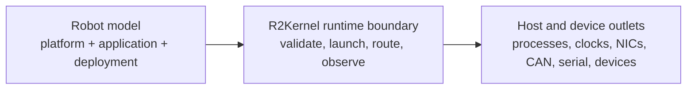

# Design Philosophy

R2Kernel models each robot as a software-defined composition before it models
individual processes, sockets, launch scripts, or device permissions.

The central rule is this.

```text
Robot = Platform + Application + Deployment
```

- Platform means what the robot is and what it can provide.
- Application means what the robot should do.
- Deployment means which concrete packages run, where they run, and how they
  are connected.

The runtime kernel validates and operates that composition. It is not just a
message library. It owns the boundary where robot intent becomes managed
execution, runtime routing, timing visibility, and admitted host resources.

## Runtime-Kernel Boundary

R2Kernel uses the phrase runtime kernel to describe ownership, not to claim that
it replaces Linux. It sits between robot application intent and the deployed
host system.



That boundary gives R2Kernel responsibility for these decisions.

- which subsystem identities exist in the robot composition
- which public contracts are provided and required
- which bindings connect concrete subsystem instances
- which communication surface carries each interaction
- which managed package is launched as which instance
- which host resources are admitted before a subsystem depends on them
- which federation and timing state can be trusted at runtime

R2Kernel does not replace Linux, device drivers, vendor fieldbus stacks,
simulation engines, planning systems, or AI application logic. It makes the
runtime boundary explicit so those pieces can be composed into one governed
robot.

## Robot Before Process

Many robotics stacks begin with process shape.

```text
start this node -> connect this topic -> open this socket -> access this device
```

That is useful during early development, but the robot definition often becomes
implicit in scripts, parameter files, network addresses, and operator memory.

R2Kernel starts one level higher.

- a platform declares what the robot can provide
- an application declares which API contracts it requires
- a deployment binds that application to concrete subsystem instances
- the runtime validates and operates the resulting composition

Subsystems still matter, but they are not the first concept. They are the
runtime units inside a robot composition.

## Platform And Application

R2Kernel separates robot capability from application intent.

A platform is the reusable robot body and capability surface. It is built from
gateway, component, and compound-role subsystems, but applications should not
need to know every lower-level implementation choice.

An application is selected behavior for that platform. It should declare the
API contracts it requires instead of hardcoding a vendor component, gateway,
host name, or simulator identity.

Deployment is where a product team, integrator, or developer chooses the
concrete subsystem instances that satisfy both sides.

```text
platform capability -> application requirement -> deployment binding
```

## Hardware Boundary

All device-level hardware is behind gateway subsystems.

Servo drivers, fieldbus devices, sensors, cameras, serial devices, and similar
physical outlets are treated as hardware. Component subsystems consume gateway
API contracts instead of opening those devices directly.

This keeps the architecture clear.

- gateway subsystems own device boundaries for physical hardware or simulator-backed devices
- component subsystems implement reusable robotics functions
- compound subsystems declare robot-level physical and spatial integration
- app subsystems implement the selected task behavior

## Runtime Boundary

R2Kernel treats subsystem execution as a runtime boundary.

A communication library can move messages, but it cannot decide whether a
process is allowed to use a CPU core, NIC, CAN interface, serial device, or
browser-facing listener after that process has already started outside the
runtime.

R2Kernel therefore uses managed packages, lifecycle state, runtime-owned routing,
and host-local resource admission to make execution explicit before user code
depends on host resources.

The same boundary is visible in the operator surfaces. Runtime can show
subsystem lifecycle state, bindings, communication contracts, package
instances, resource leases, and host reachability because those are modeled as
runtime facts instead of hidden process-side assumptions.

## Host Boundary

One robot can begin as a single-host deployment and later span multiple hosts.
The subsystem model should remain stable in both cases.

R2Kernel uses federation as the host-to-host relation. Subsystem code should keep
addressing logical interfaces and capabilities. The runtime owns route metadata,
remote visibility, forwarding policy, and cross-host timing interpretation.

Timing follows the same principle. R2Kernel does not inject one artificial global
clock object into every subsystem. Each host uses its own clock, and host-level
time synchronization makes timestamps and timed requests comparable when a
deployment spans machines.

## Related Pages

- [Robot, Application, And Deployment](../concepts/robot-application-deployment-model.md)
- [Subsystems, Roles, And Interfaces](../architecture/subsystems-and-contracts.md)
- [Communication Surfaces](../architecture/communication-surfaces.md)
- [Managed Packages and Runtime Instances](../architecture/managed-packages-and-app-runtime.md)
- [Resource Authority](../architecture/resource-authority.md)
- [Federation Time Model](../architecture/federation-time-model.md)
