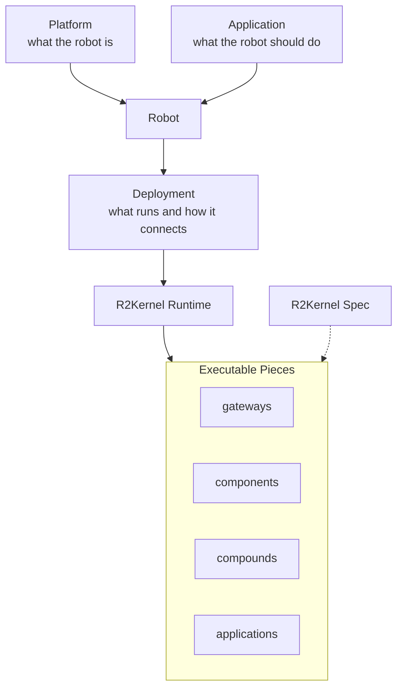
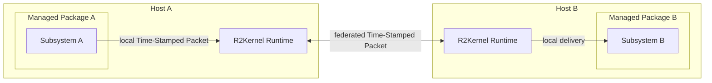

# R2Kernel in 3 Minutes

R2Kernel is easiest to understand as a runtime kernel for software-defined robots.

R2Kernel models the robot before it models a process. Each deployment describes
one robot composition, a reusable platform plus an application, made
concrete by deployment data.

```text
Robot = Platform + Application + Deployment
```

The runtime owns the concerns around that definition, including validation, launch,
spec-defined communication, federation, timing state, diagnostics, and resource
admission.



## The Core Objects

<div class="r2kernel-term-list" markdown>
<div class="r2kernel-term-row" markdown>
<div class="r2kernel-term-name">Robot</div>
<div class="r2kernel-term-body">The top-level R2Kernel composition unit. A robot is one platform, one application selection, and the deployment data that binds concrete runtime pieces together.</div>
</div>

<div class="r2kernel-term-row" markdown>
<div class="r2kernel-term-name">Platform</div>
<div class="r2kernel-term-body">The app-less definition of what the robot is and what it can provide. Deeper pages break it into parts, slots, gateway and component contracts, physical composition, and compound API exports.</div>
</div>

<div class="r2kernel-term-row" markdown>
<div class="r2kernel-term-name">Application</div>
<div class="r2kernel-term-body">The top-level app for one robot. It declares the platform API contracts it requires and may constrain optional platform compatibility labels.</div>
</div>

<div class="r2kernel-term-row" markdown>
<div class="r2kernel-term-name">Deployment</div>
<div class="r2kernel-term-body">The concrete composition. It chooses the packages to run, records launch modes and host placement, and connects gateway, component, compound, and application pieces.</div>
</div>

<div class="r2kernel-term-row" markdown>
<div class="r2kernel-term-name">Subsystem</div>
<div class="r2kernel-term-body">The executable and contract-bearing unit inside a robot composition. After the robot, application, and deployment model is clear, subsystems are the concrete gateway, component, compound, or application pieces that run.</div>
</div>

<div class="r2kernel-term-row" markdown>
<div class="r2kernel-term-name">Managed Package</div>
<div class="r2kernel-term-body">The deployable execution unit that wraps one subsystem. A package declares the entrypoint, arguments, environment, resource claims, and optionally a static package frontend.</div>
</div>

<div class="r2kernel-term-row" markdown>
<div class="r2kernel-term-name">R2Kernel Runtime</div>
<div class="r2kernel-term-body">The host runtime that validates deployments, launches managed packages, admits requested resources before start, carries time-stamped packets, and routes communication locally or across federation.</div>
</div>

<div class="r2kernel-term-row" markdown>
<div class="r2kernel-term-name">R2Kernel Spec</div>
<div class="r2kernel-term-body">The public contract vocabulary implemented by subsystems and exported by platforms. It defines message schemas, API contracts, components, and communication surfaces.</div>
</div>

<div class="r2kernel-term-row" markdown>
<div class="r2kernel-term-name">Time-Stamped Packet</div>
<div class="r2kernel-term-body">The packet exchanged between subsystems with timing metadata attached by the runtime. R2Kernel uses this timing context to support local and cross-host execution semantics.</div>
</div>

</div>

Terminology rule. Use **subsystem** for the runtime unit that registers,
launches, communicates, and is validated by R2Kernel. The word `component` appears
in two controlled places. In `role: component`, it means a subsystem role for a
replaceable robot function between gateways and application layers. In
public contract IDs such as `component.*`, it means the compatibility contract
or API bundle exposed by that role. Do not use `component` as a generic synonym
for subsystem. API contracts use domain namespaces such as `api.motion.*`,
`api.locomotion.*`, and `api.io.*`.

## Federation

When one robot spans machines, each host keeps its own managed packages and
subsystems. Federation connects the R2Kernel runtimes on those hosts, then each
runtime routes the time-stamped packet to its local subsystems. Federation is
host composition for one robot, not the primary model for a fleet.



Subsystem code still thinks in terms of the same robot deployment and
spec-defined communication model. R2Kernel owns the cross-host route and local
delivery.

## The Practical Rule

Use R2Kernel when the robot system needs the following.

- a robot definition that separates platform, application, and deployment
- a stable subsystem model from local development to multi-host deployment
- explicit contracts instead of ad-hoc message shapes
- control-owned remote routing instead of per-subsystem socket wiring
- managed launch and resource admission for product deployments
- timing state that is visible and accepted before one-way cross-host timing is
  trusted

Continue with [Installation](../getting-started/installation.md), then
[Quickstart](../getting-started/quickstart.md) for the first installed run.
For deeper concepts, use
[Robot, Application, And Deployment](../concepts/robot-application-deployment-model.md)
or [Design Philosophy](design-philosophy.md). Current compatibility and limits
are collected in the [current release notes](../releases/index.md).
