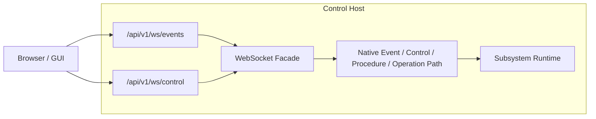

# WebSocket Facade

This page describes the WebSocket integration boundary for clients that stay
outside the native R2Kernel runtime path.

## Why This Exists

Browser-based frontends and similar GUI clients do not participate in native R2Kernel transport directly.

They do not join the native subsystem communication path or own federation
transport.

So R2Kernel exposes a control-owned WebSocket facade for those clients.

This keeps the native runtime path inside the control backend and subsystem runtime while allowing browser-facing integration.

## Shape

The browser talks to the facade, and the facade talks to the native runtime path behind the control backend boundary.

## Endpoints

The WebSocket facade exposes two endpoints.

- `/api/v1/ws/events`
- `/api/v1/ws/control`

These endpoints are owned by the control backend.

## `/api/v1/ws/events`

`/api/v1/ws/events` is the browser-facing event stream.

At this boundary, the client can.

- subscribe to Event channels
- unsubscribe from Event channels
- clear subscriptions
- receive streamed Event messages for subscribed channels

The control backend reads from the native Event side and emits browser-facing event messages over this WebSocket stream.

`/api/v1/ws/events` is a live observation stream. A browser client that subscribes
after a native Event publisher is already running should expect messages
published after the WebSocket subscription is active; it should not expect a
full replay of historical runtime traffic. The stream is live and nondurable.

Bridge health and delivery counters are available through the documented host
status surface. Use those counters to distinguish an inactive source, an empty
subscription, and a client that is not consuming messages.

There is no browser-side Event publish path at this boundary.

This browser-facing observation path covers these cases.

- regular Event channels
- Operation feedback
- Operation result
- Operation state

So `/api/v1/ws/events` is a subscribe-only observation path, not a WebSocket Event publish path into R2Kernel.

Some WebSocket payloads and diagnostics still use the field name `topic`. In
user-facing terms, treat that value as the Event channel key.

## `/api/v1/ws/control`

`/api/v1/ws/control` is the browser-facing control channel.

At this boundary, the client can send control messages such as the following.

- `procedure.call`
- `operation.start`
- `operation.cancel`
- `operation.query`

The browser does not call the native Control path directly.

Instead.

1. the browser sends a WebSocket control message to the control backend
2. the control backend resolves the target subsystem and procedure/operation
3. the control backend invokes the native control path behind the runtime boundary
4. the browser receives a WebSocket response message

So `/api/v1/ws/control` is a facade over the native control model, not a replacement for it.

## Architectural Role

The WebSocket facade should be understood as a boundary adapter.

It is not an additional subsystem-to-subsystem transport primitive.

Its role is this.

- keep browser clients outside native runtime transport paths
- keep control ownership of routing and transport policy
- expose a browser-safe integration path for GUI and frontend code

In other words.

- native subsystem transport remains centered on Event and Control
- Procedure and Operation remain semantic layers on top of that native control model
- browser-facing integration goes through the control-owned WebSocket facade

## Boundary And Limitations

This facade is useful for UI and browser integration, but it should not be confused with the native runtime hot path.

The native transport model remains underneath.

- Event for asynchronous data
- Control for point-to-point periodic request/response exchange
- Procedure and Operation as semantic layers on top of those capabilities

The WebSocket layer is an outside-facing adapter over that native runtime model.

The facade has an important limitation.

- `/api/v1/ws/events` is subscribe-only and does not publish native Event traffic into R2Kernel
- `/api/v1/ws/control` accepts ordinary control requests, but it does not expose timed-execution fields
- WebSocket control is therefore an immediate request path, not a synchronized timed-control path
- timed execution belongs to the native Control / Procedure / Operation path inside the synchronized R2Kernel runtime
- outside clients do not participate in that native synchronized runtime boundary

So this facade should be understood as follows.

- a GUI and browser integration path
- an observation and ordinary control path
- not the timed-control entry point for R2Kernel

Related pages.

- [Communication Surfaces](../architecture/communication-surfaces.md)
- [Host Control WebSocket API](../api/host-control-websocket-api.md)
- [Browser and WebSocket Facade](../tutorials/advanced-websocket-facade.md)
