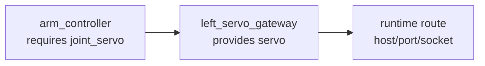

# Subsystem Binding Manifests

R2Kernel uses manifests to separate subsystem contracts from deployment wiring.

The rule is this.

```text
subsystem manifest = role plus what this subsystem provides and requires
deployment manifest = how required interfaces are bound to provider instances
runtime registry = where the bound subsystem is currently reachable
```

Subsystem code should not hardcode the concrete subsystem name of another
subsystem. It should use a logical requirement name, and the deployment manifest
binds that requirement to a provider instance.

## Subsystem Manifest

Every managed subsystem has a `r2kernel.subsystem` manifest.

```yaml
kind: r2kernel.subsystem
version: 1

subsystem:
  name: arm_controller
  role: component

requires:
  joint_servo:
    contract: api.actuator.servo.v1
    cardinality: one
    required: true

provides:
  manipulator:
    contract: component.manipulator.v1
```

`subsystem.role` is required. Supported roles are `app`, `component`, `gateway`,
and `compound`. `provides` declares interfaces implemented by the subsystem;
`requires` declares logical dependencies used by the subsystem. Contracts on
public subsystem interfaces must refer to installed R2Kernel spec dictionary
contracts. Component subsystems provide `component.*`; gateways normally expose
device-facing `api.*`; declarative compounds require `component.*` and may
project selected component APIs through `exports`. Apps may require or provide
only Event, Procedure, and Operation endpoints. A Control endpoint anywhere in
an app-facing API contract makes that contract ineligible, even when the app
reaches it through a compound export. Platform-specific adapters remain
components even when they wrap only one gateway channel.

Role compatibility is part of binding validation. Apps may bind directly to a
component or to a component-backed compound export, but never to a gateway.
Components may bind to gateways. Compounds may require component bundles and
declare spatial ports, mounts, and exports; they declare no `provides` interface
or endpoint and never bind to gateways. A compound requirement may refer to a
component bundle whose conformance set includes Control APIs for that component's
gateway integration; the compound does not call those endpoints.

Private or tutorial-only wiring must be explicit.

```yaml
provides:
  sim_debug:
    contract: tutorial.robot_cleaner.debug.v1
    visibility: internal
```

`visibility` defaults to `public`. Public interfaces are the compatibility
surface seen by robot slots and applications. Internal interfaces are allowed
for mechanics tutorials, tests, and private wiring, but they do not claim
product compatibility. A platform slot or compound export cannot be backed by
an internal interface.

For a typed internal binding, reference an `api.*` contract from a package-local
spec root on both sides and declare that root in `package.yaml` under
`contracts.spec_roots`. Keep `visibility: internal` and the explicit endpoint
lists. This lets the caller and provider prepare the request/response codecs
before Ready and compare their fingerprints. A private wiring name and endpoint
names alone do not describe the message types needed by the caller. The Cleaner
Robot gripper and Gateway demonstrate this with their private digital I/O API;
the API remains outside the official dictionary.

When a public interface contract is a canonical `component.*` id, the SDK
expands the component into its conformance API contracts and validates the
corresponding runtime registration against the installed spec dictionary.
`provides` and `requires` decide binding direction. The
contract spec defines the public compatibility surface.
Do not repeat endpoint lists on public interfaces. Event, Control, Procedure,
and Operation endpoints are part of the referenced contract. The `endpoints`
field is only for explicit internal/tutorial wiring that is not claiming public
product robot compatibility.

Runtime endpoint registration is closed-world. A subsystem may only register
endpoints that come from its public R2Kernel spec contracts or from explicit
`visibility: internal` endpoint lists in its manifest. Role checks apply to
those resolved endpoint kinds as well: app interfaces cannot register or
consume Control endpoints, and a compound cannot implement endpoints itself.
Do not create Event, Control, Procedure, or Operation endpoint names
dynamically at runtime. Put dynamic identifiers such as `request_id`,
`operation_id`, `object_id`, or `task_id` in the message payload.

## Compound API Exports

A compound can expose selected APIs from its required component contracts
without implementing a proxy.

```yaml
requires:
  navigation:
    contract: component.navigation.v1

exports:
  goal_navigation:
    contract: api.navigation.v1
    from:
      requirement: navigation
```

Only a compound may declare `exports`. The source must be one of its public
`component.*` requirements, and the exported `api.*` contract must occur in
that component spec's `conformance_apis`. An exported API may contain Event,
Procedure, and Operation endpoints, but no Control endpoints. Compound-to-
gateway requirements and bindings are invalid; there is no legacy exception.
An export contains no endpoints or code. At runtime, the logical app binding
remains visible as `app -> compound.export`, while SDK calls resolve through
`compound.requirement -> component.provider`.

## Spatial Declaration

Communication bindings and spatial topology are declared separately. A
component provider maps the spatial ports required by its `component.*` spec to
local frame names.

```yaml
spatial:
  participation: required
  ports:
    base:
      direction: import
      semantic: mounting_frame
      frame: arm_base
    tool:
      direction: export
      semantic: tool_center_point
      frame: tool0
```

The component spec determines the required port names and directions. The
subsystem manifest determines the concrete local frame names. A claim is
rejected when required component ports are missing or have the wrong direction.

A compound can connect the spatial ports of its logical requirements.

```yaml
spatial:
  participation: required
  mounts:
    - name: arm_on_body
      parent:
        requirement: mobility
        port: body
      child:
        requirement: manipulation
        port: base
      transform:
        translation: [0.18, 0.0, 0.12]
        rotation_xyzw: [0.0, 0.0, 0.0, 1.0]
```

Deployment validation resolves the requirement names through normal bindings.
The runtime qualifies local names as `<subsystem>/<frame>` and combines compound
mounts with dynamic transforms reported by subsystem SDKs. See [Spatial Model
And Frame Graph](../concepts/spatial-model.md).

## Deployment Manifest

A deployment manifest binds a consumer requirement to a provider interface.

```yaml
kind: r2kernel.deployment
version: 1

subsystems:
  arm_controller:
    manifest: ./arm_controller/subsystem.yaml
  left_servo_gateway:
    manifest: ./left_servo_gateway/subsystem.yaml

bindings:
  arm_controller.joint_servo:
    to: left_servo_gateway.servo
```

For reusable packages, use `instances:`. Each key is the concrete runtime
subsystem identity. The entry may point directly at a subsystem manifest or at a
package directory containing `package.yaml`. By default, the package resolves
`subsystem.yaml`; use `subsystem_manifest` only for a non-default relative path.

```yaml
kind: r2kernel.deployment
version: 1

instances:
  demo.left_manipulator:
    package: ./packages/manipulator_servo
    params:
      subsystem.name: demo.left_manipulator
      controller.robot_id: left_ps_ca
  demo.right_manipulator:
    package: ./packages/manipulator_servo
    params:
      subsystem.name: demo.right_manipulator
      controller.robot_id: right_ps_ca
  demo.isaac_sim_gateway:
    manifest: ./subsystem.yaml

bindings:
  demo.left_manipulator.actuator_servo_gateway:
    to: demo.isaac_sim_gateway.actuator_servo_gateway
  demo.right_manipulator.actuator_servo_gateway:
    to: demo.isaac_sim_gateway.actuator_servo_gateway
```

`subsystems:` validates that the manifest's declared `subsystem.name` matches the
deployment key. `instances:` allows the same reusable manifest to appear under
multiple runtime identities.

The binding key is always.

```text
<consumer-subsystem>.<required-interface>
```

The target is either a provided interface or a compound export.

```text
<provider-subsystem>.<provided-interface>
```

Subsystem names may contain dots. A subsystem name has at most 128 UTF-8 bytes
and no NUL character, the limit of a Control source identity; Control refuses
to register a longer name, and its refusal does not repeat the name. Binding
references split at the rightmost dot,
so `demo.mobile_base.actuator_servo_gateway` means subsystem
`demo.mobile_base` and required interface
`actuator_servo_gateway`.

The loader rejects missing subsystem manifests, missing provider interfaces,
unsupported cardinality, duplicate subsystem or instance names, contract
mismatches, and forbidden role routes before the subsystem becomes ready.
In particular, an app-to-gateway binding and any compound-to-gateway binding are
invalid, even when both ends use the same `api.*` contract.

## Compound Export Resolution

Deployment resolution follows a compound export through the component
requirement it selects. An app may bind directly to a component or use this
component-backed path:

```text
app requirement -> compound export -> compound component requirement -> component provider interface
```

The resolver checks every hop for a declared target, interface, contract, public
visibility, component role, eligible endpoint kinds, and cycles. The source
component API selected for an app export must not contain Control endpoints.
Direct app-to-gateway and compound-to-gateway bindings are rejected.

`r2kernel deploy validate` applies the same component-backed rule to declarative
exports: the selected source must connect to an actual public component provider
and the exported API must be eligible for an app interface.

At runtime, only `bound` returns a resolved physical subsystem and provider
interface. Every failure response leaves those resolved fields empty. This
prevents an SDK from sending a call to the compound alias after its component
target has failed to resolve.

| Runtime state | Meaning |
| --- | --- |
| `bound` | the complete selected route resolved to a callable provider interface, whether the binding is direct or uses an export |
| `target_missing` | the outer logical binding names no registered target subsystem |
| `interface_missing` | the outer logical binding target lacks the named interface or export |
| `contract_mismatch` | the outer logical binding has an incompatible contract, including a mismatch on the compound export itself |
| `export_unbound` | the compound requirement selected by an export has no binding |
| `export_target_missing` | an export path names a missing target subsystem |
| `export_interface_missing` | an export path lacks the selected provider interface |
| `export_contract_mismatch` | an export path has an incompatible contract |
| `export_visibility_mismatch` | an export path reaches a non-public interface or requirement |
| `export_role_mismatch` | the export owner is not a compound or the export path does not terminate at a component provider |
| `export_cycle` | export traversal encountered a cycle or exhausted its 16-hop traversal limit |
| `export_invalid` | the export declaration or its required path is structurally invalid |

Python deployment resolution follows a static export path to the actual component
provider. When Python receives a runtime response, a state other than `bound`,
or a `bound` response without both resolved fields, is rejected rather than
silently replaced by the compound alias or static target.

The live runtime resolver checks the registered binding graph. It relies on the
manifest validation completed before registration and does not reload component
spec files on every resolution.

Deployments can also reference a robot manifest and application manifest. That
layer validates robot slots, optional platform compatibility labels, and
subsystem bindings before runtime
reconciliation runs. See
[Robot/Application/Deployment Manifests](robot-application-deployment-manifests.md).

## Availability

Binding validation is structural. It does not require the provider process to
already be running.

This distinction matters for cyclic or mutually dependent subsystems. A valid
binding can be structurally configured while the route is still unresolved. In
that case the subsystem can report a waiting or not-ready state instead of
treating the deployment as invalid.

Use these state boundaries.

| State | Meaning |
|---|---|
| `INVALID_CONFIG` | Manifest or binding structure is invalid |
| `WAITING_BINDING` | Binding is valid but provider route is not available yet |
| `BOUND` | Binding target is known and route resolution succeeded |
| `READY` | Required bindings and local registrations are ready |
| `DEGRADED` | A previously available runtime binding was lost |

## SDK Shape

Python and C++ subsystems parse a manifest at construction time.

```python
from r2kernel.wrapper import ComponentSubsystem


class ArmController(ComponentSubsystem):
    def __init__(self) -> None:
        super().__init__(
            name="arm_controller",
            manifest_path="subsystem.yaml",
            deployment_manifest_path="r2kernel.deployment.yaml",
        )

    def move(self, params):
        target = self.binding_target("joint_servo")
        return self.call_procedure(
            target=target,
            procedure="set_position",
            params=params,
        )
```

Convenience APIs such as `call_bound_procedure(...)` and
`start_bound_operation(...)` can resolve the target internally from the logical
binding name.

C++ subsystems use the same manifest boundary. Pass
`SubsystemOptions::manifest_path` and `SubsystemOptions::deployment_manifest_path`
directly, set `R2KERNEL_SUBSYSTEM_MANIFEST` and `R2KERNEL_DEPLOYMENT_MANIFEST`, or
start the package through `r2kernel launch run` or `r2kernel deploy up`, which
pass launch bindings through `R2KERNEL_BINDINGS`. The C++ `Subsystem` offers the
same `binding_target`, `resolve_binding`, `call_bound_procedure` and
`start_bound_operation` methods:

```cpp
auto response = call_bound_procedure("joint_servo", "set_position", params_json);
```

## Diagram Model

The manifest split enables four diagram levels.



- Static interface diagrams use subsystem manifests only.
- Deployment wiring diagrams add the deployment manifest.
- Runtime diagrams add route and health state from the control backend.
- Spatial diagrams add resolved ports, static mounts, dynamic transforms, and
  stale-edge diagnostics from the runtime frame graph.

The Web Console Runtime graph uses the live control status snapshot. When a
subsystem SDK reports manifest and binding status, the graph can show running
subsystems, provided interfaces, required interfaces, and binding edges in the
same view as Event and Control endpoints.
