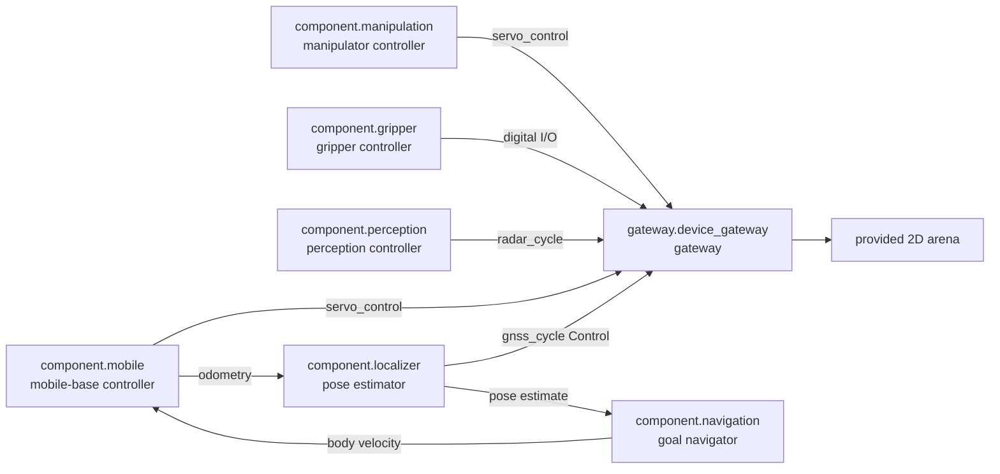

# Step 3 - Add Component Subsystems

The gateway subsystem is the lower layer that wraps the provided 2D simulator. Now
add the component subsystems that make the robot usable.

```text
component.mobile
component.manipulation
component.gripper
component.incinerator
component.perception
component.localizer
component.navigation
```

Each package in this step is a `role: component` subsystem. Its public
compatibility surface is a `component.*` contract. In other words,
the subsystem is the runtime unit, and the component contract is the API-contract
set that other subsystems and robot slots depend on.

The component packages declare `resources.sandbox.network: brokered`. Their
control logic uses R2Kernel interfaces and gateway APIs, and cannot create
direct IP or hardware socket connections. A component may include static
frontend assets or request a declared frontend backend through the resource
broker; see [Advanced Subsystem Packages](advanced-subsystem-packages.md).

## Run This Stage

From the installed root.

```text
cd <prefix>
r2kernel launch run tutorials/subsystems/component.mobile \
  --instance component.mobile \
  --bind actuator_servo=gateway.device_gateway.actuator_servo \
  --detach

r2kernel launch run tutorials/subsystems/component.perception \
  --instance component.perception \
  --bind radar_source=gateway.device_gateway.radar_source \
  --detach

r2kernel launch run tutorials/subsystems/component.manipulation \
  --instance component.manipulation \
  --bind actuator_servo=gateway.device_gateway.actuator_servo \
  --detach

r2kernel launch run tutorials/subsystems/component.gripper \
  --instance component.gripper \
  --bind digital_io=gateway.device_gateway.digital_io \
  --detach

r2kernel launch run tutorials/subsystems/component.incinerator \
  --instance component.incinerator \
  --bind timed_digital_output=gateway.device_gateway.timed_digital_output \
  --detach

r2kernel launch run tutorials/subsystems/component.localizer \
  --instance component.localizer \
  --bind gnss_source=gateway.device_gateway.gnss_source \
  --bind odometry=component.mobile.mobile_base \
  --detach

r2kernel launch run tutorials/subsystems/component.navigation \
  --instance component.navigation \
  --bind localization=component.localizer.localizer \
  --bind mobility=component.mobile.mobile_base \
  --detach
```

Expected terminal output shape.

```text
Each command returns a detached package launch result.
```

Open the browser with the same host rule from Step 1. For a local browser and
runtime, use the following.

```text
http://127.0.0.1:8091/
```

For a remote runtime host, use the following.

```text
http://<runtime-host>:8091/
```

The browser should still show `world online`. No application is running, so
teleop commands are not active yet.

This step uses `--bind` because each package is launched one subsystem at a
time. It does not run `r2kernel deploy up` yet.

## 1. Mobile-Base Component Subsystem

Open the manifest.

```text
nano tutorials/subsystems/component.mobile/subsystem.yaml
```

`component.mobile` provides the standard mobile-base component contract and requires
the standard actuator gateway.

```yaml
requires:
  actuator_servo:
    contract: api.actuator.servo.v1

provides:
  mobile_base:
    contract: component.mobile_base.v1
```

Open the code.

```text
nano tutorials/subsystems/component.mobile/mobile_controller.py
```

The component subsystem registers the mobile-base API surface behind that
component contract.
`velocity_command`, `set_velocity_reference`, `set_velocity_limits`, `get_velocity_limits`, `stop`,
`get_status`, `enable_drive`, `disable_drive`, `clear_fault`, and the
`mobile_base_state` / `fault_state` events. Navigation components use the
`velocity_command` Control endpoint, whereas applications use the
`set_velocity_reference` Procedure through the compound export. In either case,
the mobile component, not the app, sends `servo_control` to the bound gateway on
the Control plane. Each request carries a `ControlCycle` (a generation chosen at
start, a strictly increasing sequence, and intent `command`) and an
`ActuatorCommand` whose target names the base axes `base_vx`, `base_vy`, and
`base_wz` in `target_velocity`. The component accepts a cycle only when the
response status is `applied`. It retains timing and validity responsibility at
this boundary. The gateway exposes `servo_control` only as the canonical
actuator-servo Control surface.

The mobile component also publishes `api.locomotion.odometry.v1`. Its odometry
starts at zero and accumulates relative motion in `odom`; it does not claim to
know the robot's position in the arena map.

## 2. Manipulator Component Subsystem

```text
nano tutorials/subsystems/component.manipulation/manipulation_controller.py
```

`component.manipulation` exposes the manipulator controller spec surface.

| Endpoint | Meaning |
| --- | --- |
| `joint_velocity` | low-latency joint-space control surface |
| `stop`, `pause`, `resume` | trajectory control procedures |
| `set_tcp`, `set_payload` | tool and payload procedures |
| `move_j`, `move_l`, `move_c` | programmed motion operations |
| `joint_state`, `tool_pose`, `motion_state`, `tool_settings` | state events |

These tutorial motion results acknowledge command acceptance only, not physical
actuator completion. Timeout, rejection, and malformed Boolean acknowledgements
fail the operation without advancing confirmed commanded state. Velocity uses
the same check. An ambiguous delivery is never automatically replayed; observe
provider state separately to establish physical effects.


The key pattern is standard-interface composition. The controller exposes
manipulator endpoints and sends low-level actuator commands through the gateway.

```text
component.manipulation -> gateway.device_gateway.servo_control
```

As with the mobile controller, this tutorial stage calls the bounded
`servo_control` Control endpoint through the bound actuator-servo interface,
naming the arm-extension and gripper axes in the command target and accepting
only an `applied` response.

The application and compound subsystem are added later. They should not need to know
how the simulator stores arm state.

## 3. Gripper Component Subsystem

```text
nano tutorials/subsystems/component.gripper/gripper_controller.py
```

`component.gripper` exposes the following.

| Procedure | Meaning |
| --- | --- |
| `open` | release held object |
| `close` | grab reachable trash |
| `get_gripper_state` | read the gripper output state |

This is still a virtual gripper, but it has the same boundary a real gripper
component subsystem would need. Application code asks for an action, and the
subsystem owns how to realize it through a digital I/O Gateway Control. The
Gateway's former Procedures are represented by explicit private Controls; the
gripper's public Procedures remain on the Component.

## 4. Incinerator Component Subsystem

```text
nano tutorials/subsystems/component.incinerator/incinerator_controller.py
```

`component.incinerator` owns the configured output channel and bounded pulse.
The app invokes the standard `trigger` Procedure through the compound's
`trash_disposal` export, while the component holds the
physical output through periodic `digital_output_control` Control exchanges:
a `command` cycle sets the output, and `keep` cycles maintain the same state
revision. Each exchange carries a validity deadline. If the component or
connection stops refreshing the output within the binding's update-gap lease,
the gateway watchdog forces the output to its safe-off state.

This boundary is intentional: a device channel with domain meaning, pulse
duration, liveness, or safety behavior is a component even when it controls only
one bit. The compound does not know the channel index or implement burn.

The incinerator requires `api.io.digital.timed_output.v1` as
`timed_digital_output`. The gateway enforces the update-gap lease and safe-off
behavior. The gripper binds to an internal typed Control adapter for the
tutorial's one-shot set/readback behavior. The standard
`api.io.digital.output.v1` Procedure contract remains available to Components,
but a Gateway does not expose Procedures.

## 5. Perception Component Subsystem

```text
nano tutorials/subsystems/component.perception/perception_controller.py
```

`component.perception` polls the standard Gateway `radar_cycle` Control for
time-stamped rotating sectors. It aggregates recent observations, assigns its
own track identities, and exposes application-facing Procedures. The Gateway
does not provide tracked objects or simulator identities.

| Procedure | Meaning |
| --- | --- |
| `scan` | bounded query over recently observed and tracked returns |
| `front` | current front field-of-view contacts |
| `nearest` | nearest current contact |

The radar application later depends on this perception component contract. The
teleop app does not. That difference is captured in deployment bindings.

## 6. Localization Component Subsystem

Open the localizer manifest and implementation.

```text
nano tutorials/subsystems/component.localizer/subsystem.yaml
nano tutorials/subsystems/component.localizer/localizer.py
```

`component.localizer` requires two independent measurement surfaces.

| Requirement | Source | Meaning |
| --- | --- | --- |
| `gnss_source` | `gateway.device_gateway.gnss_source` | standard sample-exchange Control returning an antenna-frame WGS84 fix |
| `odometry` | `component.mobile.mobile_base` | smooth relative motion in `odom` |

It converts GNSS coordinates to local ENU map metres relative to the configured
WGS84 origin, accounts for the antenna mounting translation, and takes yaw from
odometry rather than a truth-heading field. It publishes `api.localization.v1`
and leaves `odom -> cleaner_base` under the mobile component's ownership. This
makes the receiver source and localization algorithm independent replaceable
components.
The localizer republishes the existing `api.positioning.absolute_pose.v1`
`position_fix` Event from the Component boundary; the Gateway no longer
publishes Events. For GNSS field and time semantics, see
[GNSS Source And Localization](gnss-localization.md).

## 7. Navigation Component Subsystem

Open the navigation manifest and implementation.

```text
nano tutorials/subsystems/component.navigation/subsystem.yaml
nano tutorials/subsystems/component.navigation/navigation.py
```

`component.navigation` separates goal navigation from both the top-level Radar
application and the low-level mobile controller. It does not own a transform or
declare a spatial surface. The localization API supplies the map-relative body
pose and identifies its frames, while the frame graph remains owned by the
localizer and mobile-base components.

```text
map -- localizer --> odom -- mobile base --> body
```

The localizer owns `map -> odom`, the mobile-base component owns `odom -> body`,
and navigation uses the resulting pose for goal control through its system
interfaces.

| Requirement or surface | Source or contract | Meaning |
| --- | --- | --- |
| `localization` | `component.localizer.v1` | current map-relative body pose |
| `mobility` | `component.mobile_base.v1` | bounded body velocity and stop control |
| `navigation` | `component.navigation.v1` | goal/path operations and navigation state |

The component accepts `navigate_to_pose` and `follow_path` operations from the
compound layer. It converts those goals into periodic velocity commands for
the mobile component while using localizer estimates for feedback. The Radar
application added later selects a target but does not implement this control
loop itself.

## 7. Why Mixed Endpoint Types Are Used Here

The cleaner component subsystems use a mix of Control and Procedure endpoints.

```text
velocity command
scan once
extend once
grab once
burn once
```

Components use Control endpoints such as `velocity_command`, `joint_velocity`,
and the gateway's `servo_control` for periodic or latency-sensitive exchanges.
Applications submit body-motion references through a Procedure; the mobile
component then owns the timed gateway exchange for each accepted reference.
Other Procedure endpoints cover scan, gripper open/close, stop, and status
queries. The gripper's low-level digital output exchange is a private Control
adapter; it is not an application-facing Procedure.
A contract endpoint must not be registered on both planes.

The simulated world state is read by the browser from the provided simulator API,
not from a robot gateway endpoint.
The tutorial does not require you to manually run separate transport examples;
the cleaner robot demonstrates the communication shape in context.

## 8. Verify Component Declarations

Check that each component subsystem requires/provides public `component.*`
contracts.

```text
r2kernel subsystem status component.mobile
r2kernel subsystem status component.manipulation
r2kernel subsystem status component.gripper
r2kernel subsystem status component.perception
r2kernel subsystem status component.localizer
r2kernel subsystem status component.navigation
```

You should see active subsystem sessions. The relevant contracts are these.

```text
component.mobile_base.v1
component.manipulator.v1
component.gripper.v1
api.actuator.servo.v1
api.io.digital.output.v1
api.io.digital.timed_output.v1
api.perception.query.v1
api.sensor.radar.source.v1
api.sensor.gnss.source.v1
component.perception.v1
api.positioning.absolute_pose.v1
api.locomotion.odometry.v1
component.localizer.v1
api.navigation.v1
component.navigation.v1
```

## Cleaner Robot Graph After This Step



The robot still has no top-level application. It now has reusable component
subsystems that implement standard component contracts and can be combined by
different applications.

Continue to [Step 4 - Define Platform](define-platform.md).
