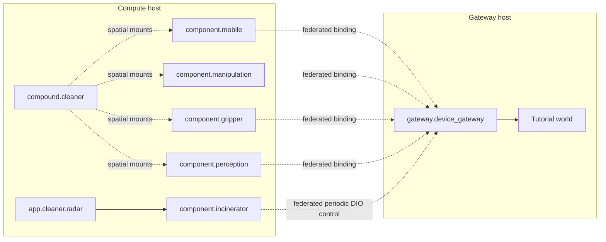

# Advanced Federation

This exercise runs the same cleaner robot graph across two runtime hosts. It is
not a separate federation demo. The gateway side stays near the simulator or
hardware, and the compute side runs components, spatial composition, and the app.

```text
same cleaner graph + two runtime hosts = federated cleaner topology
```

## 1. What You Will Run

Use two hosts with the same R2Kernel release installed.

| Host | Cleaner responsibility |
| --- | --- |
| Gateway host | tutorial world, simulator API, and `gateway.device_gateway` |
| Compute host | `component.*`, `compound.cleaner`, and `app.cleaner.radar` |



`r2kernel deploy up` is host-local. It does not SSH into the peer host. In this
exercise, you start each host's local processes directly, then validate the
combined graph with the cleaner external deployment manifest.

## 2. Configure Both Hosts

Fresh installations bind runtime listeners to loopback. Before either host is
exposed, complete [Web and API Security](../operate/web-and-api-security.md):
configure API credentials accepted by the peer, browser credentials, restricted
network allowlists, and TLS termination for browser/API access. Provision the
same federation key and key ID on both hosts, then select `required` frame
security. Restrict native traffic to these two hosts through firewall/VPN policy;
Web/API authentication does not protect all native ports.

For authenticated HTTP peer discovery, the Control service must also have an
outbound API token accepted by its peer. `security.api.token_env` names the
environment variable loaded in that service. Readiness-helper key files do not
provision this service credential; configure both paths without disabling API
authentication.

Provision `<prefix>/etc/federation.key` as a root-owned regular file with
mode `0600`, using the same 16–4096 bytes of key material on both hosts. Keep
the parent directories root-owned and non-writable by the runtime group. The
installer's resource authority policy must name this file; restart
`r2kernel-resourced.service` after a policy change. Control loads the key through
the authenticated broker rather than reading it as the service user. The shared
key defines one trusted cluster: it does not isolate a malicious host that has
already been entrusted with that key. See
[Manager and Device Authorization](../reference/resource-authority.md).

The addresses `192.0.2.20` (gateway) and `192.0.2.21` (compute) below are
documentation examples. Replace them with the actual peer-facing addresses.
On the gateway host, bind only the required listeners and list the compute peer.

```text
. <prefix>/env.sh
sudo /usr/local/bin/r2kernel-config --config <prefix>/runtime/config.yaml set security.enabled true
sudo /usr/local/bin/r2kernel-config --config <prefix>/runtime/config.yaml set security.api.require_auth true
sudo /usr/local/bin/r2kernel-config --config <prefix>/runtime/config.yaml set security.web.login_required true
sudo /usr/local/bin/r2kernel-config --config <prefix>/runtime/config.yaml set control.ui_host 127.0.0.1
sudo /usr/local/bin/r2kernel-config --config <prefix>/runtime/config.yaml set control.management_https.bind_host 127.0.0.1
sudo /usr/local/bin/r2kernel-config --config <prefix>/runtime/config.yaml set control.api_host 192.0.2.20
sudo /usr/local/bin/r2kernel-config --config <prefix>/runtime/config.yaml set control.advertise_host 192.0.2.20
sudo /usr/local/bin/r2kernel-config --config <prefix>/runtime/config.yaml set federation.bind_host 192.0.2.20
sudo /usr/local/bin/r2kernel-config --config <prefix>/runtime/config.yaml set control_transport.bind_host 192.0.2.20
sudo /usr/local/bin/r2kernel-config --config <prefix>/runtime/config.yaml set federation.peers '[{"host":"192.0.2.21","api_port":8001}]'
sudo /usr/local/bin/r2kernel-config --config <prefix>/runtime/config.yaml set federation.security.mode required
sudo /usr/local/bin/r2kernel-config --config <prefix>/runtime/config.yaml set federation.security.key_id cleaner-lab
sudo /usr/local/bin/r2kernel-config --config <prefix>/runtime/config.yaml set federation.security.key_file <prefix>/etc/federation.key
sudo /usr/local/bin/r2kernel-config --config <prefix>/runtime/config.yaml validate
sudo systemctl restart r2kernel-control.service
```

On the compute host, do the inverse.

```text
. <prefix>/env.sh
sudo /usr/local/bin/r2kernel-config --config <prefix>/runtime/config.yaml set security.enabled true
sudo /usr/local/bin/r2kernel-config --config <prefix>/runtime/config.yaml set security.api.require_auth true
sudo /usr/local/bin/r2kernel-config --config <prefix>/runtime/config.yaml set security.web.login_required true
sudo /usr/local/bin/r2kernel-config --config <prefix>/runtime/config.yaml set control.ui_host 127.0.0.1
sudo /usr/local/bin/r2kernel-config --config <prefix>/runtime/config.yaml set control.management_https.bind_host 127.0.0.1
sudo /usr/local/bin/r2kernel-config --config <prefix>/runtime/config.yaml set control.api_host 192.0.2.21
sudo /usr/local/bin/r2kernel-config --config <prefix>/runtime/config.yaml set control.advertise_host 192.0.2.21
sudo /usr/local/bin/r2kernel-config --config <prefix>/runtime/config.yaml set federation.bind_host 192.0.2.21
sudo /usr/local/bin/r2kernel-config --config <prefix>/runtime/config.yaml set control_transport.bind_host 192.0.2.21
sudo /usr/local/bin/r2kernel-config --config <prefix>/runtime/config.yaml set federation.peers '[{"host":"192.0.2.20","api_port":8001}]'
sudo /usr/local/bin/r2kernel-config --config <prefix>/runtime/config.yaml set federation.security.mode required
sudo /usr/local/bin/r2kernel-config --config <prefix>/runtime/config.yaml set federation.security.key_id cleaner-lab
sudo /usr/local/bin/r2kernel-config --config <prefix>/runtime/config.yaml set federation.security.key_file <prefix>/etc/federation.key
sudo /usr/local/bin/r2kernel-config --config <prefix>/runtime/config.yaml validate
sudo systemctl restart r2kernel-control.service
```

The two hosts must reach each other on control API port `8001` and the selected
native federation and Control relay ports. Federation status is exchanged only
through each peer's authenticated Host API hello on that API port, so Host API
authentication and `federation.security` both apply to peer discovery; there is
no separate status port. A peer entry without `api_port` uses this host's
`control.api_port`. `control_transport.bind_host` also controls its default
outbound interface. Validate authenticated peer discovery and
native routes before starting robot workloads. This configuration sequence is
not a substitute for testing the actual firewall, TLS, credentials, and timing
acceptance on both hosts.

## 3. Start The Gateway Host

Run the tutorial world on the gateway host.

```text
. <prefix>/env.sh
cd <prefix>
python3 tutorials/run_sim_world.py --host 127.0.0.1
```

In another gateway-host terminal, start only the gateway subsystem.

```text
. <prefix>/env.sh
cd <prefix>
r2kernel launch run tutorials/subsystems/gateway.device_gateway \
  --instance gateway.device_gateway \
  --set simulator.url=http://127.0.0.1:8092 \
  --detach
```

Check that the gateway is registered locally.

```text
r2kernel launch list
r2kernel subsystem bindings gateway.device_gateway
```

The gateway host owns the simulator or hardware resource boundary. Nothing on
the compute host should open the simulator or hardware directly.

## 4. Start The Compute Host

On the compute host, start each component and bind it to the federated gateway
interfaces.

```text
. <prefix>/env.sh
cd <prefix>
r2kernel launch run tutorials/subsystems/component.mobile \
  --instance component.mobile \
  --bind actuator_servo=gateway.device_gateway.actuator_servo \
  --detach

r2kernel launch run tutorials/subsystems/component.manipulation \
  --instance component.manipulation \
  --bind actuator_servo=gateway.device_gateway.actuator_servo \
  --detach

r2kernel launch run tutorials/subsystems/component.gripper \
  --instance component.gripper \
  --bind digital_io=gateway.device_gateway.digital_io \
  --detach

r2kernel launch run tutorials/subsystems/component.perception \
  --instance component.perception \
  --bind radar_source=gateway.device_gateway.radar_source \
  --detach

r2kernel launch run tutorials/subsystems/component.localizer \
  --instance component.localizer \
  --bind gnss_source=gateway.device_gateway.gnss_source \
  --bind odometry=component.mobile.mobile_base \
  --detach

r2kernel launch run tutorials/subsystems/component.navigation \
  --instance component.navigation \
  --bind localization=component.localizer.localizer \
  --bind mobility=component.mobile.mobile_base \
  --detach

r2kernel launch run tutorials/subsystems/component.incinerator \
  --instance component.incinerator \
  --bind timed_digital_output=gateway.device_gateway.timed_digital_output \
  --detach
```

Start the compound subsystem.

```text
r2kernel launch run tutorials/subsystems/compound.cleaner \
  --instance compound.cleaner \
  --bind localization=component.localizer.localizer \
  --bind mobility=component.mobile.mobile_base \
  --bind navigation=component.navigation.navigation \
  --bind manipulation=component.manipulation.manipulator \
  --bind gripper=component.gripper.gripper \
  --bind incinerator=component.incinerator.incinerator \
  --bind perception=component.perception.perception \
  --detach
```

Start the radar app on the compute host.

```text
r2kernel launch run tutorials/subsystems/app.cleaner.radar \
  --instance app.cleaner.radar \
  --bind navigation=compound.cleaner.goal_navigation \
  --bind manipulation=compound.cleaner.articulated_trajectory \
  --bind gripper=compound.cleaner.gripper_control \
  --bind trash_disposal=compound.cleaner.trash_disposal \
  --bind perception=compound.cleaner.object_detection \
  --detach
```

## Accept Live Bindings Before Running The App

`launch --bind` records the declared bindings with Control for the launched
lease. Control applies each one, through the same validation as an operator
binding, when that instance's process registers; a target that is not available
yet is reported as pending in the launch binding intents that
`r2kernel subsystem bindings` lists. Cross-host targets also need the peer
registration and usable codec contexts, so this guide binds every requirement
explicitly once both hosts are up. On the compute host, run the following after
the launch blocks above and before pressing the application Start button:

```text
sudo r2kernel subsystem bind component.mobile.actuator_servo gateway.device_gateway.actuator_servo
sudo r2kernel subsystem bind component.manipulation.actuator_servo gateway.device_gateway.actuator_servo
sudo r2kernel subsystem bind component.gripper.digital_io gateway.device_gateway.digital_io
sudo r2kernel subsystem bind component.perception.radar_source gateway.device_gateway.radar_source
sudo r2kernel subsystem bind component.localizer.gnss_source gateway.device_gateway.gnss_source
sudo r2kernel subsystem bind component.localizer.odometry component.mobile.mobile_base
sudo r2kernel subsystem bind component.navigation.localization component.localizer.localizer
sudo r2kernel subsystem bind component.navigation.mobility component.mobile.mobile_base
sudo r2kernel subsystem bind component.incinerator.timed_digital_output gateway.device_gateway.timed_digital_output
sudo r2kernel subsystem bind compound.cleaner.localization component.localizer.localizer
sudo r2kernel subsystem bind compound.cleaner.mobility component.mobile.mobile_base
sudo r2kernel subsystem bind compound.cleaner.navigation component.navigation.navigation
sudo r2kernel subsystem bind compound.cleaner.manipulation component.manipulation.manipulator
sudo r2kernel subsystem bind compound.cleaner.gripper component.gripper.gripper
sudo r2kernel subsystem bind compound.cleaner.incinerator component.incinerator.incinerator
sudo r2kernel subsystem bind compound.cleaner.perception component.perception.perception
sudo r2kernel subsystem bind app.cleaner.radar.navigation compound.cleaner.goal_navigation
sudo r2kernel subsystem bind app.cleaner.radar.manipulation compound.cleaner.articulated_trajectory
sudo r2kernel subsystem bind app.cleaner.radar.gripper compound.cleaner.gripper_control
sudo r2kernel subsystem bind app.cleaner.radar.trash_disposal compound.cleaner.trash_disposal
sudo r2kernel subsystem bind app.cleaner.radar.perception compound.cleaner.object_detection
```

The list covers remote and local requirements. Inspect `r2kernel subsystem bindings --json` and require every
selection to be `bound`; a rejected mutation has a nonzero exit status. Wait for
the target host's accepted source/interface view to agree before issuing
Controls. A stale registration or rebind requires fresh approval; a matching
name or release version is not enough.

Remote exports must be public contracts. The gripper's package-local custom
digital-I/O contract is explicitly public for this example; other internal
interfaces do not become remotely accessible.

## 5. Validate The Split Cleaner Graph

The installed tutorial includes an external deployment manifest for this
development-style bring-up.

```text
r2kernel deploy validate tutorials/deployments/dev/radar.deployment.yaml
r2kernel deploy status tutorials/deployments/dev/radar.deployment.yaml
r2kernel subsystem bindings
```

Expected result.

- compute-host instances are local managed processes
- `gateway.device_gateway` is visible through federation
- component requirements bind to the gateway provider interfaces
- app API requirements bind to the compound exports and resolve to their selected component providers
- `component.incinerator` owns burn and refreshes a lease-controlled gateway output
- `compound.cleaner` declares spatial composition and the exported API selection only
- the development deployment is external, so it validates and observes but does
  not start or stop these manually launched processes

Deployment validation checks the manifest contract; a successful status query
does not prove that every remote provider, binding or typed route is healthy.
Inspect the selected peer, registration, binding and codec readiness before
starting the workload. Distinguish missing discovery from a discovered provider
that has not acquired an accepted live binding. Network configuration alone
cannot resolve a rejected interface or codec identity.

For a retained Event integration fixture, the `wait_event_path.py` readiness
helper accepts separate `--sender-api-key-file` and `--receiver-api-key-file`
inputs. Provision owner-only regular key files (for example mode `0600`) and
protect remote status requests with loopback SSH forwarding or verified HTTPS.
The default header is `Authorization: Bearer`; each side can instead select
`X-R2Kernel-API-Key` with its `--*-auth-header` option. Do not put keys in URLs,
queries, command arguments, or logs, and do not turn off API security or required
federation authentication to obtain readiness. Before starting a gated publisher,
allocate a new private `0700` run directory (for example with `mktemp -d`) and use
an absent gate inside it. Give this attempt a unique publisher name and topic.
The helper requires this run's startup acknowledgement and current publisher
registration before opening the gate; a route left ready by another publisher
is insufficient. The publisher and helper refuse preexisting gates; neither
deletes caller paths. A failed later attempt must not reuse an earlier success.
The helper opens only an exclusive empty `0600` regular gate.
Use `--scope cross-host` with `--receiver-status-url`; both sender forwarding
readiness and receiver inbound readiness are required. Readiness also requires
each host to list the other in `subscriptions_synced`, which records a peer's
acknowledgement of the current subscription request. A peer that has not
acknowledged it stays in `subscription_ack_pending` and is not ready; see
[Deployment Checks](../operate/deployment-checks.md#6-cross-host-event-gate). With
`--require-time-sync`, both hosts' clock checks must pass. Authorization failures
leave the current fresh gate closed. Explicit topology fallback is diagnostic
smoke only and never accepts one-way latency evidence, even with accepted clocks.
Acquisition/publication timestamps and callback metadata have the public clock
contracts documented by their APIs, not a public transport-envelope layout.


## 6. Observe The Federated Cleaner

Forward the gateway host loopback viewer/API through SSH as described in
[Start Simulation World](start-simulation-world.md#if-the-runtime-is-remote),
then open the local viewer.

```text
http://127.0.0.1:8091/
```

Inspect the compute host Web Console through a loopback SSH forward; opening
the peer API on `8001` does not expose the Console:

```text
ssh -N -L 127.0.0.1:18080:127.0.0.1:18080 operator@192.0.2.21
```

Then open `http://127.0.0.1:18080/` and use the Console login policy. With native
HTTPS enabled, forward `127.0.0.1:18443` to remote `127.0.0.1:18443` instead and
open `https://127.0.0.1:18443/`; verify the configured device certificate rather
than disabling certificate checks. HTTP may redirect to HTTPS. Keep the Console
bind loopback and the SSH local bind explicitly loopback.

`18080` (Console HTTP), `18443` (enabled native HTTPS), and `8001` (canonical API)
are defaults, not mandatory ports. Preserve and forward explicit configured
overrides, including legacy `8081`/`8443`. Only explicit `control.ui_port: 0`
shares the API listener; inspect the effective configuration before forwarding.
Console management uses `/console/api/v1` with a session when login is ON;
canonical `/api/v1` uses API keys when API security is ON.

The world viewer should show the same cleaner behavior as the single-host radar
deployment. The difference is ownership. Gateway resource policy stays on the
gateway host, while application and component workloads stay on the compute
host.

## 7. Cleanup

On the compute host, terminate the manually launched processes.

```text
r2kernel subsystem terminate app.cleaner.radar
r2kernel subsystem terminate compound.cleaner
r2kernel subsystem terminate component.incinerator
r2kernel subsystem terminate component.navigation
r2kernel subsystem terminate component.localizer
r2kernel subsystem terminate component.perception
r2kernel subsystem terminate component.gripper
r2kernel subsystem terminate component.manipulation
r2kernel subsystem terminate component.mobile
```

On the gateway host, terminate the gateway and stop the tutorial world terminal.

```text
r2kernel subsystem terminate gateway.device_gateway
```

Stop the world terminal with `Ctrl-C`.

## What This Proves

- federation is a host-level runtime relation, not a new subsystem role
- subsystem manifests and bindings remain the same across host boundaries
- deployment validation can describe a split graph without starting remote
  processes
- gateway-host resource policy can stay near the hardware
- compute-host app and component policy can stay near CPU or GPU resources
- the cleaner graph can move from single host to multi-host without changing
  application intent

For timing-sensitive multi-host work, combine this with
[Time Sync Operations](../operate/time-sync-operations.md) before enabling real
actuators.
