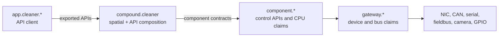

# Advanced Resource Policy

This exercise keeps the cleaner tutorial context and adds the resource-control
layer. It does not introduce a new robot. It shows where host resources are
claimed when the same cleaner graph moves from the simulator toward hardware.

```text
cleaner package boundary + resource claim = resource authority
```

The runnable part uses the installed cleaner packages and a no-hardware CPU
probe. Hardware-specific checks are optional and should be run only on hosts
with the matching NIC, CAN interface, or device node.

## 1. Start The Cleaner Under Managed Launch

Start the tutorial world in one terminal.

```text
. <prefix>/env.sh
cd <prefix>
python3 tutorials/run_sim_world.py --host 127.0.0.1
```

For a remote runtime host, retain the loopback binding above and use the
[SSH forwarding procedure](start-simulation-world.md#if-the-runtime-is-remote) from
the core tutorial. The simulator accepts state-changing commands without
authentication; keep it on loopback.

In another terminal, start the complete radar deployment.

```text
. <prefix>/env.sh
cd <prefix>
r2kernel deploy up tutorials/deployments/radar.deployment.yaml --replace
```

Inspect the managed leases created by the deployment.

```text
r2kernel resource status
r2kernel launch list
```

Expected result.

- cleaner subsystem instances are visible as managed runtime sessions
- the package runtime directories are under `<prefix>/var/run/packages`
- the simulated gateway has no hardware resource claim yet
- packages with browser backends use brokered network sandboxing for package frontends

This proves the first resource-control rule. A package launched outside R2Kernel
can run code, but it does not receive a managed resource lease.

## 2. Inspect The Cleaner Resource Boundary

Open the simulated gateway package.

```text
nano tutorials/subsystems/gateway.device_gateway/package.yaml
```

Then open one component package.

```text
nano tutorials/subsystems/component.mobile/package.yaml
```

In the simulator, both packages have empty hardware claims because the gateway
talks to the provided simulator HTTP API. On a physical cleaner, the same roles
would claim different resources.

| Cleaner role | Resource policy |
| --- | --- |
| `gateway.device_gateway` | owns NIC, raw Ethernet fieldbus, CAN, serial, camera, GPIO, or device-node claims |
| `component.*` | may request CPU affinity or scheduler policy, but should not own hardware interfaces |
| `compound.cleaner` | no raw device claim; it declares spatial composition and exported APIs only |
| `app.cleaner.*` | no device claim; it calls exported APIs and uses brokered package frontend networking |

The rule is intentional. Hardware access belongs behind gateways. Components
can need compute resources, but they should not bypass a gateway to touch host
interfaces directly.

## 3. Run A CPU Resource Probe

The installed tutorial includes a no-hardware resource fixture. It represents a
timing-sensitive component workload that asks the resource authority for CPU
placement.

```text
r2kernel package validate tutorials/advanced/resource_control/cpu_package
r2kernel package build tutorials/advanced/resource_control/cpu_package \
  --out /tmp/r2kernel-cleaner-cpu-probe \
  --force
r2kernel launch run /tmp/r2kernel-cleaner-cpu-probe \
  --config <prefix>/runtime/config.yaml \
  --instance component.cpu_probe
```

Expected result.

- package validation succeeds
- the process starts through `r2kernel-resourced`
- launch output reports the resource attachment result
- the worker prints its PID and, on Linux hosts with `taskset`, the CPU affinity

The fixture exits after a short sleep. Run `r2kernel resource status` while it is
active if you want to see the transient lease.

If the host has only one CPU core, change the fixture's CPU claim to core `0`
before running the probe. The installed test sandboxes normally have more than
one core.

## 4. Run A Gateway Outlet Smoke

The following checks are optional because they need host-specific hardware.
Choose the one that matches the resource a real cleaner gateway would own.

First inspect available host resources.

```text
r2kernel resource inventory
```

For an IP network gateway, choose a real NIC and run the brokered network
probe.

```text
ip -brief link
python3 tutorials/advanced/resource_control/brokered_network/bin/make_package.py \
  --out /tmp/r2kernel-brokered-network \
  --interface eth0 \
  --repo-root "$PWD"
r2kernel launch run /tmp/r2kernel-brokered-network \
  --config <prefix>/runtime/config.yaml \
  --detach
```

For an EtherCAT or other raw Ethernet fieldbus gateway, declare a link-layer
claim in the gateway package.

```yaml
resources:
  link_layer:
    interfaces:
      - name: eth1
        mode: exclusive
        access: raw_packet
        protocols: [ethercat]
        grant:
          capabilities: [CAP_NET_RAW]
```

Approve the capability for `eth1` in the root-managed resource authority
policy: add `{"interface": "eth1", "capabilities": ["CAP_NET_RAW"]}` to
`link_layer_grants` in `/etc/r2kernel/resource-authority.json`, then run
`sudo systemctl restart r2kernel-resourced`. The capability applies to every
interface of the host.

To ship one gateway package for hosts with different adapter names, write
`name: "{{params.fieldbus_nic}}"` with a declared `string` parameter and pass
`--set fieldbus_nic=eth1` at launch; see
[Select the adapter per instance](../operate/resource-control.md#select-the-adapter-per-instance).

Validate and launch that gateway package on the target host.

```text
r2kernel package validate ./my_ethercat_gateway
r2kernel launch run ./my_ethercat_gateway \
  --config <prefix>/runtime/config.yaml \
  --detach
r2kernel resource status
```

For a SocketCAN gateway, choose a CAN interface and run the CAN probe.

```text
ip -details link show type can
python3 tutorials/advanced/resource_control/brokered_can/bin/make_package.py \
  --out /tmp/r2kernel-brokered-can \
  --interface can0 \
  --repo-root "$PWD"
r2kernel launch run /tmp/r2kernel-brokered-can \
  --config <prefix>/runtime/config.yaml \
  --detach
```

For a serial device gateway, choose an unused TTY node and run the managed
device smoke.

```text
ls -l /dev/ttyAMA* /dev/ttyS* /dev/ttyUSB* /dev/ttyACM* 2>/dev/null
tutorials/advanced/resource_control/brokered_device/bin/run_tty_smoke.sh \
  --device /dev/ttyAMA10 \
  --prefix <prefix>
```

Expected result for these gateway outlet checks.

- direct unmanaged access is blocked where a brokered sandbox is requested
- accepted handles are delivered through the resource broker
- conflicting claims on the same exclusive resource are rejected
- raw Ethernet fieldbus traffic stays inside the gateway process after launch

## 5. Read The Cleaner Shape Backward

The resource boundary is the same whether the gateway talks to a simulator or a
physical bus.



For the simulator, `gateway.device_gateway` calls the simulator API. For a real
cleaner, a product gateway package would replace that simulator call with CAN,
serial, camera, EtherCAT, GPIO, or another interface claim.

## 6. Cleanup

Stop the radar deployment.

```text
r2kernel deploy down tutorials/deployments/radar.deployment.yaml
```

If a probe is still running, stop it by lease id from `r2kernel resource status`.

```text
r2kernel resource stop <lease-id>
```

Stop the tutorial world terminal with `Ctrl-C`.

Continue to [Advanced Federation](advanced-federation.md).
