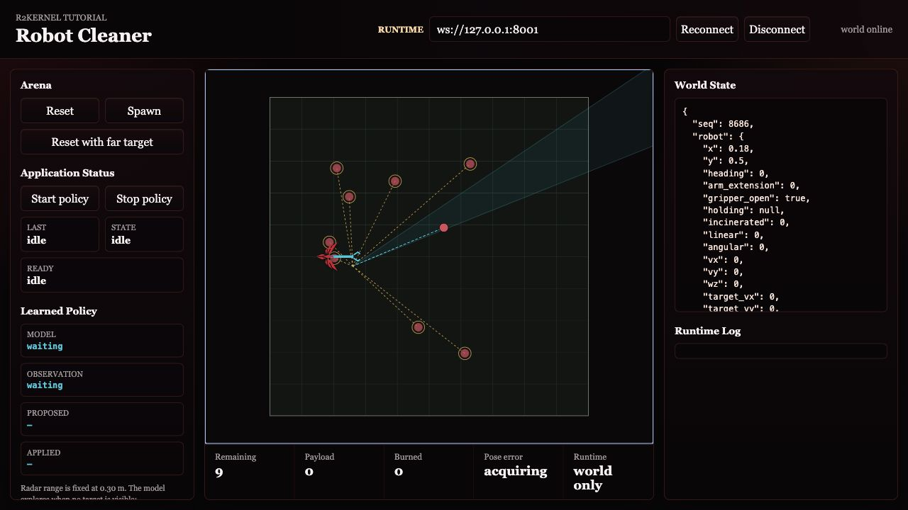
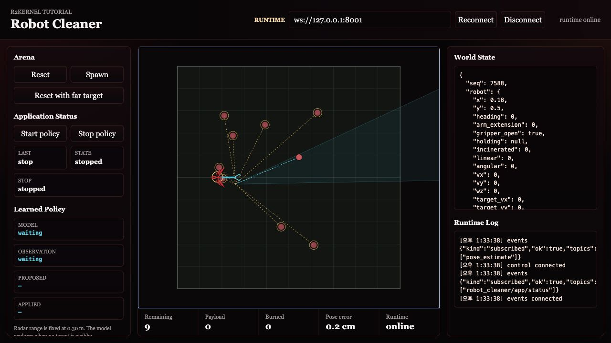
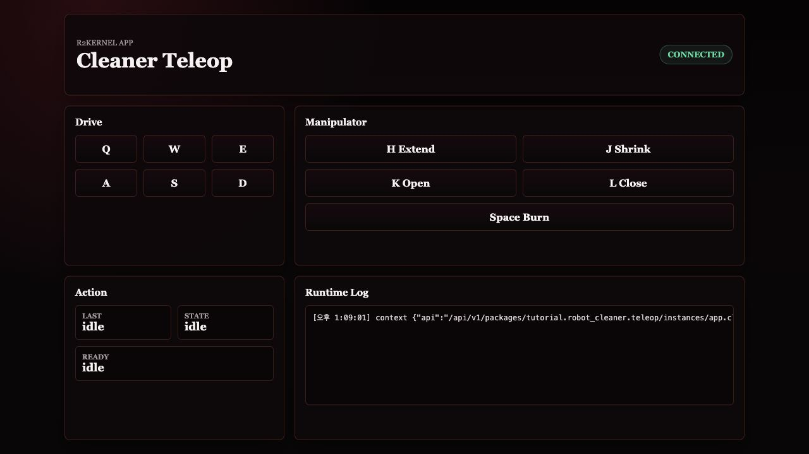
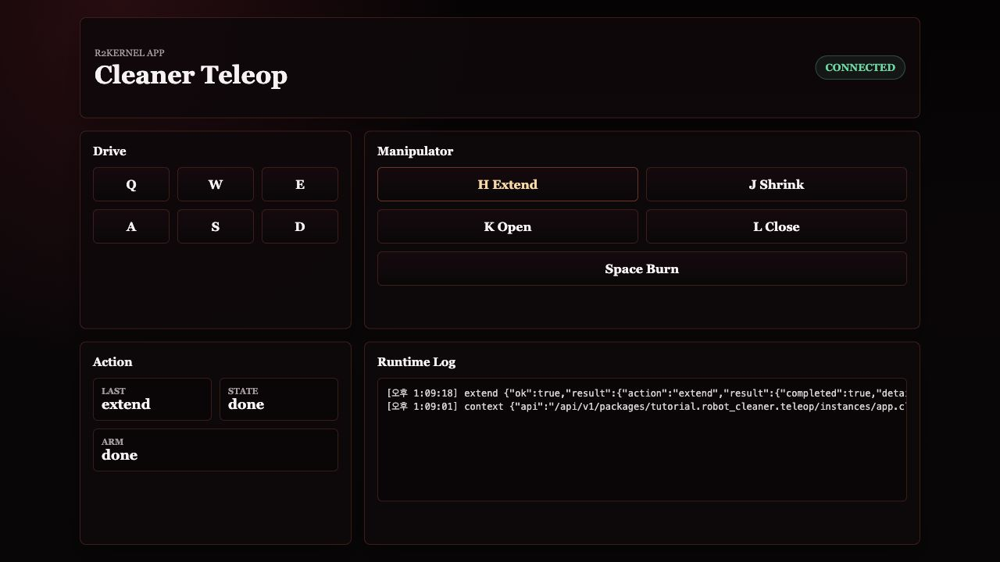
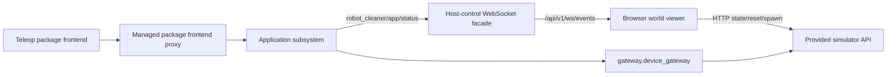

# Advanced Teleop Package Frontend

The core tutorial used Radar first because it can run as a deployment without
installing an application-specific browser frontend. Teleop is the next layer.
It shows how a managed package can carry its own frontend and command its
application subsystem instance through the runtime-managed proxy.

Neither browser surface is a native R2Kernel subsystem. Both stay outside the
native runtime boundary and connect through `r2kernel-control`.

```text
world viewer -> /api/v1/ws/events      -> observe app events
world viewer -> /api/v1/ws/control     -> invoke a running app's start/stop procedures
world viewer -> simulator API   -> read/reset tutorial world state
teleop UI    -> package proxy   -> command app.cleaner.teleop
```

Native Event, Control, Procedure, and Operation traffic stays inside the R2Kernel
host. Browser UIs only see host-control and managed package frontend facades.

## 1. Open The World Viewer

The cleaner arena is a static world viewer under `tutorials/frontend`.

The important files are these.

| File | Role |
| --- | --- |
| `index.html` | page layout and canvas |
| `styles.css` | arena styling |
| `app.js` | app-event WebSocket client, simulator polling, and teleop input |
| `arena_renderer.mjs` | canvas drawing of the arena, robot, radar scan, and localization estimate |
| `action_status.mjs` | action status panel for app and teleop results |
| `payloads.mjs` | payload unwrapping for WebSocket and simulator responses |

`run_sim_world.py` serves this directory with Python's static HTTP server. It
does not start robot subsystems.

## 2. Read The World Viewer Facade Client

Open the browser code.

```text
nano tutorials/frontend/app.js
```

Near the top of the file, the frontend defines the app event topic.

```javascript
const APP_TOPIC = 'robot_cleaner/app/status';
```

It opens two WebSockets.

```text
/api/v1/ws/events
/api/v1/ws/control
```

`/api/v1/ws/events` receives application status. `/api/v1/ws/control` carries the
world viewer's **Start policy** and **Stop policy** requests to the application
selected by the `app` query parameter. Teleop drive and manipulation commands use
the package frontend. World state, reset, and trash spawn use the provided simulator HTTP
API; those are not robot gateway endpoints.

For Teleop, **Start policy** marks the app active; it does not begin autonomous
motion. **Stop policy** stops the current drive command and marks the app
inactive. Use the Teleop frontend below to issue movement and manipulation
commands. These buttons do not create or replace a deployment.

## 3. Prepare The Platform For Teleop

Stop the radar deployment if it is still running.

```text
r2kernel deploy down tutorials/deployments/radar.deployment.yaml
```

Start the reusable platform without an application.

```text
r2kernel deploy up tutorials/deployments/stages/robot.deployment.yaml
```

Open this URL.

```text
http://127.0.0.1:8091/?app=app.cleaner.teleop
```

The page starts simulator polling immediately and attempts to attach to the
runtime event stream automatically. Before a runtime connection is available,
the browser remains useful as a simulator view. It shows `world online` when
the simulator API is reachable and upgrades to `runtime online` when the
runtime event facade is reachable.



After the automatic runtime connection is online, the world viewer also shows
application status events. At this point, no teleop app is running yet, so the
status may remain idle. The connected illustration shows a stopped application;
the runtime connection indicator is the same before launching Teleop.



## 4. Install And Launch Teleop

Teleoperation uses an installed managed package instance as the command target,
and the controls are packaged with the teleop application subsystem.

The installed Teleop package also needs the tutorial support files. The normal
installer places them under `<runtime-prefix>/tutorials`, usually
`<prefix>/tutorials`. Keep that directory available to the launched app.
For a custom installation prefix or a separate source checkout, set
`R2KERNEL_TUTORIAL_ROOT` to its absolute `tutorials` directory in the package
manifest's `entrypoint.env` before building the archive. This must be the path
on the runtime host.

If the teleop package is not installed yet, build an archive and install it from
the Web Console Packages page.

```text
r2kernel package build tutorials/subsystems/app.cleaner.teleop \
  --out /tmp/r2kernel-teleop-app \
  --force
tar -czf /tmp/r2kernel-teleop-app.tgz -C /tmp/r2kernel-teleop-app .
```

Then go to **Runtime**, choose **Launch package instance**, select
`tutorial.robot_cleaner.teleop`, and launch it with this instance id.

```text
app.cleaner.teleop
```

Open the package frontend from Runtime, or use the instance URL.

```text
http://127.0.0.1:8001/api/v1/packages/tutorial.robot_cleaner.teleop/ui/?instance=app.cleaner.teleop&context=/api/v1/packages/tutorial.robot_cleaner.teleop/instances/app.cleaner.teleop/context
```

The teleop frontend is the operator control surface. It can be placed beside
the world viewer and shrinks to a narrow browser column for split-screen
testing.



## 5. Command Through The App Proxy

When the operator presses a button or key, the package frontend calls the managed
same-origin package proxy. The proxy forwards the request to the app's brokered
loopback frontend API. For teleop, the app then calls bound compound exports.

```text
teleop package frontend
  -> /api/v1/packages/tutorial.robot_cleaner.teleop/instances/app.cleaner.teleop/api/command
  -> app.cleaner.teleop
  -> compound.cleaner exported Event / Procedure / Operation APIs
  -> component.mobile / component.manipulation / component.gripper / component.incinerator
  -> gateway.device_gateway
```

This keeps the browser from bypassing the application policy.
The teleop App does not open a Control endpoint or connect to the gateway.
`component.mobile` turns accepted velocity references into timed gateway Control
commands and owns their validity bounds.

Movement keys in the teleop package frontend are hold-to-drive. The browser keeps
refreshing a short-lived velocity command while the key or button is held, and
sends stop when it is released. Movement is robot-relative. After rotating the
robot, `W` drives forward in the direction the robot is facing.

| Key | Action |
| --- | --- |
| `W` or Up | drive forward in the robot body frame |
| `S` or Down | drive backward in the robot body frame |
| `A` or Left | strafe left in the robot body frame |
| `D` or Right | strafe right in the robot body frame |
| `Q` | rotate counter-clockwise |
| `E` | rotate clockwise |
| `H` | extend the manipulator |
| `J` | shrink the manipulator |
| `K` | open the gripper |
| `L` | close the gripper |
| Space | burn trash stored in the robot body |

Manual collection is intentionally step-by-step.

1. Open the gripper with `K`.
2. Extend the manipulator with `H` toward a piece of trash.
3. Close the gripper with `L`.
4. Shrink the manipulator with `J` to bring the trash into the robot body.
5. Press Space to burn the stored payload.

If the gripper is closed while extending, the arm pushes loose trash away. If
the gripper is open while extending, the trash is not pushed; closing the
gripper near the arm tip grabs it. If you shrink without a closed gripper hold,
the trash stays in the arena. If you do not burn stored trash, it remains as
payload on the robot and can accumulate.



The teleop package frontend shows the latest command result. `Payload` in the world
viewer bottom status strip is the number of trash items currently stored in the
robot body and not yet burned.

## 6. Browser Defaults For Remote Runs

The frontend defaults to the page host for both runtime connections.

- WebSocket control backend - `ws://<page-host>:8001`
- simulator API - `http://<page-host>:8092`

On a local install, open.

```text
http://127.0.0.1:8091/?app=app.cleaner.teleop
```

For a remote runtime host, keep the simulator on loopback and use the SSH
forwarding described in [Step 1](start-simulation-world.md#if-the-runtime-is-remote).

```text
python3 tutorials/run_sim_world.py --host 127.0.0.1
```

Then start the platform deployment on that host.

```text
r2kernel deploy up tutorials/deployments/stages/robot.deployment.yaml
```

Forward port `8001` too for runtime events and the managed Teleop frontend. Then
open this URL through the forwarded ports.

```text
http://127.0.0.1:8091/?app=app.cleaner.teleop
```

Reload the world viewer after starting the platform and teleop package instance.
Use **Reconnect** only after restarting `r2kernel-control` or changing the
host/port path. The viewer's policy buttons invoke the selected running app;
they do not launch or replace its deployment. Use the teleop package frontend
only when the teleop package instance is running. Explicit
`ws`, `sim`, and `connect` query parameters are intended for automated checks or
unusual proxy layouts, not the normal tutorial path.

## Cleaner Robot Browser Graph



The world viewer is a visualization surface. The teleop package frontend is an
operator surface, but it still does not bypass the application subsystem.

Continue to [Advanced Resource Policy](advanced-resource-policy.md).
