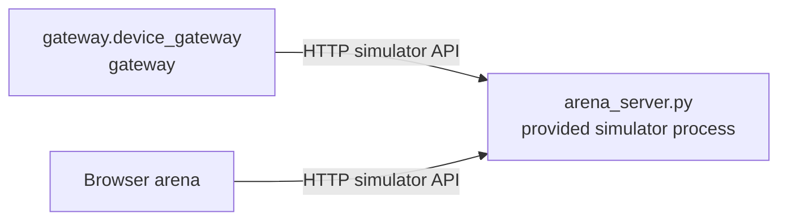

# Step 2 - Build Gateway Subsystem

The cleaner robot tutorial provides a 2D arena simulator. The simulator is not
the robot gateway that users should model. It is the environment that the robot
runs against.

The R2Kernel-facing lower boundary is a simulator-backed gateway subsystem named
`gateway.device_gateway`.

`gateway.device_gateway` owns the runtime bridge to the provided simulator.

- drive commands for the mobile base
- arm extension commands
- digital I/O commands for gripper and disposal outputs
- standard rotating-radar and GNSS source Controls

It does not own simulator administration. Reset, trash spawn, and browser world
state come from the provided simulator support API, not from the robot gateway.

The tutorial uses one compact gateway so the concept stays visible. A real robot
could use one servo gateway for all motors, separate actuator and sensor
gateways, or a vendor gateway that exposes several standard device API
contracts.

The simulator process is separate.

```text
tutorials/simulator/arena_server.py
```

It is not a R2Kernel subsystem. `run_sim_world.py` starts only the simulator and
browser. This step starts `gateway.device_gateway` as one managed package with
`r2kernel launch run`. Full deployment orchestration comes later, after the
platform and application exist.

## Run This Stage

From the installed root.

```text
cd <prefix>
r2kernel launch run tutorials/subsystems/gateway.device_gateway \
  --instance gateway.device_gateway \
  --set simulator.url=http://127.0.0.1:8092 \
  --detach
```

Keep the simulator world from Step 1 running while this command starts. The
gateway waits for the simulator API during startup because it is the robot-facing
adapter over that already-running world.

Expected terminal output shape.

```text
Launched package tutorial.robot_cleaner.device_gateway
  mode: detached
  instance: gateway.device_gateway
```

Open the browser with the same host rule from Step 1. For a local browser and
runtime, use the following.

```text
http://127.0.0.1:8091/
```

For a remote runtime host, use the following.

```text
http://<runtime-host>:8091/
```

The robot still does not move from the browser. That is correct. This stage
adds the gateway boundary only; there is no controller or application yet.

## 1. Open The Gateway Manifest

```text
nano tutorials/subsystems/gateway.device_gateway/subsystem.yaml
```

The Gateway's public robot-facing interfaces are Control-only. The integrated
rotating radar provides time-stamped sectors through a standard source Control;
it does not provide detected targets. The GNSS source provides receiver-shaped
antenna fixes through its standard source Control. Device-specific queries that
the tutorial has not promoted to a standard Control API remain internal
Component adapters.

```yaml
subsystem:
  name: gateway.device_gateway
  role: gateway

provides:
  actuator_servo:
    contract: api.actuator.servo.v1
  timed_digital_output:
    contract: api.io.digital.timed_output.v1
  digital_io:
    contract: tutorial.gateway.device_gateway.digital_io.v1
    visibility: internal
    endpoints:
      controls: [digital_output_set, digital_output_readback]
  radar_source:
    contract: api.sensor.radar.source.v1
  gnss_source:
    contract: api.sensor.gnss.source.v1
```

`api.actuator.servo.v1` and `api.io.digital.timed_output.v1` are versioned
`common_control` Controls with a typed `ControlCycle`. The simulator remains an
implementation detail behind both layers. A real gateway would translate the
public Control surfaces to EtherCAT, CAN, serial, a vendor SDK, or a simulator
API. The one-shot digital-I/O adapters are internal tutorial wiring; radar and
GNSS use versioned `common_control` sample-exchange profiles. The GNSS payload
is an antenna position, not a body pose or heading; the Localizer converts it
to the configured map frame and combines it with odometry.

## 2. Read The Gateway Code

```text
nano tutorials/subsystems/gateway.device_gateway/device_gateway.py
```

Focus on `on_initialize()`.

```python
self.register_control_endpoint("servo_control", self._servo_control)
self.register_control_endpoint("digital_output_control", self._digital_output_control)
self.register_control_endpoint("digital_output_set", self._set_digital_output)
self.register_control_endpoint("digital_output_readback", self._get_digital_output)
self.register_control_endpoint("radar_cycle", self._radar_cycle)
self.register_control_endpoint("gnss_cycle", self._gnss_cycle)
```

Register the complete declared surface before `on_initialize()` returns. The
SDK checks the manifest against these registrations before moving the Gateway
to `Ready`; with the default `strict` policy, a missing endpoint fails
initialization. Do not defer registration to `on_start()`. `Ready` is not
`Operating`: a Component or Gateway handler can receive a request before
`on_start()` finishes, so handler code must check lifecycle state and safely
reject commands until the subsystem is `Operating`.

The manifest and code must agree. The manifest says which contracts the gateway
claims to provide; the code registers the runtime endpoints required by those
contracts. Gateway public interfaces expose only Controls. The internal
`digital_output_set`/`digital_output_readback` adapters preserve the tutorial's
existing one-shot gripper behavior without exposing Procedures on the Gateway.
`timed_digital_output` supplies the separate `digital_output_control` Control
used for periodic disposal output: a `command` cycle sets the output and later
`keep` cycles maintain it within the binding's update-gap lease. When the lease
lapses, the Gateway's watchdog turns the output off.
`servo_control` is the actuator-servo Control surface from
`api.actuator.servo.v1`. Each request carries a `ControlCycle` and an
`ActuatorCommand` whose target names the commanded axes; the response reports
`applied`, `rejected`, or `device_error`. It is intentionally registered only
as a Control endpoint. `radar_cycle` returns prepared sensor sectors with acquisition
times and range/bearing returns; it never returns simulator object IDs or
world-state coordinates. The perception Component alone turns those samples
into tracked application observations. Components keep their application-facing
Procedures and Events; they call or publish through their own contracts.
`gnss_cycle` returns the latest receiver-shaped sample with an immutable sample
identity. A receiver's `no_fix` state is distinct from the absence of a new
sample. It does not return simulator truth or a localizer pose.

The radar Control port has one explicit owner: the active deployment binding
to `gateway.device_gateway.radar_source`. The Gateway checks the current
runtime binding before serving a request and again before committing its
response. The first caller cannot claim the port. Missing, ambiguous, or
changed bindings cause the request to fail. The binding check validates runtime
topology, not an authenticated caller identity or a binding epoch; those are
separate runtime guarantees.

The 2D arena server and state logic live in the provided support modules.

```text
nano tutorials/simulator/arena_server.py
nano tutorials/simulator/arena.py
```

You normally do not modify this simulator while learning R2Kernel. Treat it like a
small IsaacSim, Gazebo, vendor SDK, or hardware environment that already exists.

## 3. Understand Simulator State

The browser reads simulator state directly from the provided simulator API. That
API is tutorial infrastructure, not a robot gateway contract. It carries.

```text
robot pose
trash list
scan result
score
world size
```

This gives the cleaner UI a single source of truth for drawing the arena.

## 4. Understand The Gateway Endpoints

Components never edit simulator state directly. They call robot-facing gateway
endpoints.

| Endpoint | Called by | Effect |
| --- | --- | --- |
| `servo_control` control | mobile and manipulation components | applies base or arm actuator commands through the servo gateway surface |
| `digital_output_control` control | incinerator component through `timed_digital_output` | sets the disposal output with `command`, maintains it with `keep` under an update-gap lease, and turns it off when the lease lapses |
| `digital_output_set` internal Control | gripper component | preserves the tutorial's one-shot output-setting behavior |
| `digital_output_readback` internal Control | gripper component | reads the output state |
| `radar_cycle` standard Control | perception component | poll prepared, time-stamped sectors from the integrated rotating radar |
| `gnss_cycle` standard Control | localizer component | polls the latest antenna-frame WGS84 fix; the Localizer handles map conversion and odometry orientation |

Reset, spawn, and world-state sync are not listed because they belong to the
provided simulator API. The world is visible, but it is not the robot-facing
gateway contract.

## 5. Validate The Manifest Shape

Deployment validation will later validate this gateway as part of the whole
robot. For now, read the file and check the registered endpoint names against
the contracts.

```text
rg -n "register_control_endpoint|register_procedure|register_event_publish" tutorials/subsystems/gateway.device_gateway/device_gateway.py
```

Only Control registrations should appear in the Gateway code. The manifest's
internal endpoints and public API contracts must match those registrations.

## Cleaner Robot Graph After This Step



The simulator can exist before the gateway starts. The R2Kernel gateway subsystem is
the device adapter that exposes a Control-only robot-facing boundary. Components
provide the application-facing Events, Procedures, and Operations.

## Verify

Inspect this stage.

```text
r2kernel subsystem status gateway.device_gateway
```

Then inspect the platform plan that will later assign the same gateway package
to three robot slots.

```text
r2kernel deploy plan tutorials/deployments/stages/robot.deployment.yaml
```

Look for the following.

```text
gateway.device_gateway [gateway] slots=actuator_gateway:actuator_servo,gnss_sensor_gateway:gnss_source,radar_sensor_gateway:radar_source,timed_digital_output_gateway:timed_digital_output
```

Continue to [Step 3 - Add Component Subsystems](add-component-subsystems.md).
