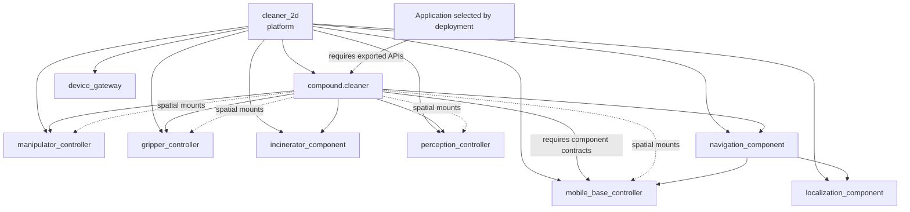

# Step 4 - Define Platform

The cleaner now has a provided simulator, a gateway subsystem, component
subsystems, and a browser view. This step turns that collection into a reusable
platform and adds the compound subsystem that declaratively owns its physical,
spatial, and exported-API composition.

The general R2Kernel composition model is this.

```text
robot = platform + application + deployment
deployment = what runs, where it runs, and how it connects
```

In this tutorial, that model is applied to the cleaner like this.

```text
platform = the cleaner's reusable body, component set, gateway set, and exported APIs
application = one behavior that runs on that robot, such as teleop or radar cleaning
```

The platform does not choose teleop, rule-based radar, or learned radar. It
declares the robot shape and API surface that those applications can use. The concrete running
pieces are still subsystems, but this step starts from the reusable platform
identity instead of from individual processes.

## Run This Stage

From the installed root.

```text
cd <prefix>
r2kernel launch run tutorials/subsystems/compound.cleaner \
  --instance compound.cleaner \
  --bind mobility=component.mobile.mobile_base \
  --bind localization=component.localizer.localizer \
  --bind navigation=component.navigation.navigation \
  --bind manipulation=component.manipulation.manipulator \
  --bind gripper=component.gripper.gripper \
  --bind incinerator=component.incinerator.incinerator \
  --bind perception=component.perception.perception \
  --detach
```

Expected terminal output shape.

```text
Launched package tutorial.robot_cleaner.cleaner_compound
  mode: detached
  instance: compound.cleaner

Bindings:
  gripper -> component.gripper.gripper
  manipulation -> component.manipulation.manipulator
  mobility -> component.mobile.mobile_base
  localization -> component.localizer.localizer
  navigation -> component.navigation.navigation
  incinerator -> component.incinerator.incinerator
  perception -> component.perception.perception
```

Open the browser with the same host rule from Step 1. For a local browser and
runtime, use the following.

```text
http://127.0.0.1:8091/
```

For a remote runtime host, use the following.

```text
http://<runtime-host>:8091/
```

The world is still visible, but no top-level app is running yet. This stage
checks that the reusable platform stack can exist before any specific
application is attached.

This still uses `r2kernel launch run`, so the required interfaces are connected
with explicit `--bind` options. The deployment command is introduced below as
validation/planning first, then as full execution in the application step.

## 1. Open The Robot Manifest

```text
nano tutorials/robot/r2kernel.robot.yaml
```

This file is the platform provider's manifest. It is not stored inside
`subsystems/compound.cleaner` because it describes the app-less platform, not
only the compound subsystem implementation.

The manifest begins with the reusable robot identity.

```yaml
kind: r2kernel.robot
version: 1

robot:
  name: cleaner_2d
  model: tutorial-cleaner-2d
  profiles:
    - tutorial.robot_cleaner.cleaner_2d.v1
```

The `profiles` field stores optional platform compatibility labels. It lets an
application say "I run on this class of robot" when that matters. Concrete
application compatibility is checked through ordinary API bindings.

## 2. Declare Spatial Ports And Mounts

The robot manifest names reusable parts and slots. Concrete frame
topology belongs to the subsystem manifests that implement the platform.

Open the mobile component manifest.

```text
nano tutorials/subsystems/component.mobile/subsystem.yaml
```

```yaml
spatial:
  participation: required
  ports:
    reference:
      direction: export
      semantic: odometry_reference
      frame: odom
    body:
      direction: export
      semantic: mobile_body
      frame: cleaner_base
```

`component.mobile_base.odometry.v1` requires these spatial ports. The component spec
defines their portable meaning, while this subsystem chooses the concrete local
frame names.

Open the compound manifest.

```text
nano tutorials/subsystems/compound.cleaner/subsystem.yaml
```

Its mounts connect bound component ports.

```yaml
spatial:
  participation: required
  mounts:
    - name: arm_on_body
      parent:
        requirement: mobility
        port: body
      child:
        requirement: manipulation
        port: base
      transform:
        translation: [0.0, 0.0, 0.0]
        rotation_xyzw: [0.0, 0.0, 0.0, 1.0]
    - name: radar_on_body
      parent:
        requirement: mobility
        port: body
      child:
        requirement: perception
        port: sensor
      transform:
        translation: [0.08, 0.03, 0.0]
        rotation_xyzw: [0.0, 0.0, 0.1305261922, 0.9914448614]
```

The mount uses logical requirement names rather than concrete subsystem names.
It remains valid when deployment selects another compatible mobile or
manipulator component. The mobile and manipulator implementations report their
changing transforms through the SDK. R2Kernel combines those dynamic transforms
with the compound's static mounts.

The mobile component owns `odom -> cleaner_base`. The localizer aliases the
mobile `reference` frame through its odometry binding and owns `map -> odom`.
The compound re-exports the localizer's `map` frame and mounts the arm, gripper,
and radar onto the localized mobile body. The radar mount deliberately has a
nonzero translation and yaw, so the tutorial can verify a real Spatial lookup
rather than an identity shortcut.

After this stage is running, inspect the graph.

```text
r2kernel frame graph
r2kernel frame lookup component.localizer/map component.manipulation/cleaner_gripper
```

## 3. Bind Software Roles To Robot Slots

The robot slots say which public contracts and subsystem roles are
required.

```yaml
slots:
  actuator_gateway:
    role: gateway
    part: device_bus
    contract: api.actuator.servo.v1
  timed_digital_output_gateway:
    role: gateway
    part: device_bus
    contract: api.io.digital.timed_output.v1
  radar_sensor_gateway:
    role: gateway
    part: radar
    contract: api.sensor.radar.source.v1
  gnss_sensor_gateway:
    role: gateway
    part: positioning
    contract: api.sensor.gnss.source.v1
  mobile_base_controller:
    role: component
    part: base
    contract: component.mobile_base.odometry.v1
  manipulator_controller:
    role: component
    part: arm
    contract: component.manipulator.v1
  gripper_controller:
    role: component
    part: gripper
    contract: component.gripper.v1
  incinerator_component:
    role: component
    part: incinerator
    contract: component.trigger_actuator.v1
  perception_controller:
    role: component
    part: radar
    contract: component.perception.v1
  localization_component:
    role: component
    part: localization
    contract: component.localizer.v1
  navigation_component:
    role: component
    part: navigation
    contract: component.navigation.v1
```

Gateway slots expose Control-only APIs. The device Gateway serves the servo,
timed digital-output, radar-source, and GNSS-source Controls.
The perception Component turns rotating radar sectors into tracked
application queries; the Localizer converts antenna-frame GNSS measurements
into local map coordinates and combines them with odometry. Only the tutorial's
direct digital-I/O Controls remain internal bindings rather than public robot
slots.

This is where `component.mobile` becomes the mobile-base component subsystem for
this platform, and `gateway.device_gateway` can become the lower gateway
boundary for several gateway slots. The robot manifest names the slots; the
deployment later chooses the concrete instances and the specific provided
interface that satisfies each slot.

The slot contracts are public R2Kernel specs. Simulator-only actions such as
resetting the arena or spawning trash are not robot slots; they stay in the
provided simulator support API.

## 4. Declare Compound API Exports

The compound requires component contracts and exposes only selected APIs from
their conformance bundles. The declarations below are checked aliases; they do
not register endpoints or run forwarding code.

```yaml
requires:
  mobility:
    contract: component.mobile_base.odometry.v1
  navigation:
    contract: component.navigation.v1
  incinerator:
    contract: component.trigger_actuator.v1

exports:
  body_motion:
    contract: api.locomotion.velocity_reference.v1
    from:
      requirement: mobility
  goal_navigation:
    contract: api.navigation.v1
    from:
      requirement: navigation
  trash_disposal:
    contract: api.actuation.trigger.v1
    from:
      requirement: incinerator
```

Every API remains implemented by the component that owns the robotics function.
The runtime follows the compound export to that component. The compound owns
only the spatial composition and public selection.

| Compound export | API contract | Why applications care |
| --- | --- | --- |
| `goal_navigation` | `api.navigation.v1` | request framed navigation without owning localization or mobile control |
| `body_motion` | `api.locomotion.velocity_reference.v1` | submit bounded body-frame references to the mobile component without App-side Control |
| `articulated_trajectory` | `api.motion.articulated.trajectory.v1` | submit manipulator trajectories |
| `gripper_control` | `api.end_effector.gripper.v1` | open and close the gripper without device-channel knowledge |
| `trash_disposal` | `api.actuation.trigger.v1` | execute the configured bounded actuator without exposing raw IO |
| `object_detection` | `api.perception.query.v1` | query object detections |

`trash_disposal` is a platform-local alias for the standard trigger-actuation API.
`component.incinerator` owns the configured output channel, periodic pulse, response
checks, and fail-safe off behavior. It reports only whether the bounded trigger
completed; the application owns the cleaner-specific burn meaning and the sequence
that combines perception, navigation, manipulation, gripper, and disposal. That task
policy does not belong in the compound.

The provided 2D arena is intentionally not a compound export. It is tutorial
infrastructure behind `gateway.device_gateway`, similar to a simulator or vendor
device API behind a real gateway.

## 5. Compare Application Requirements

Each application declares the standard APIs it needs, and may also include
platform compatibility labels when it intentionally targets a robot family.
Teleop needs mobility, articulated trajectory, gripper, and trash-disposal APIs.

```text
nano tutorials/subsystems/app.cleaner.teleop/subsystem.yaml
```

Radar requires navigation, perception query, articulated trajectory, gripper,
and trash-disposal APIs. Learned radar additionally requires localization and
body motion for its model-driven exploration.

```text
nano tutorials/subsystems/app.cleaner.radar/subsystem.yaml
```

This is the important separation.

```text
platform says what the robot can provide
application says what kind of robot it needs
deployment proves the two fit together
```

## 6. Validate Deployment Plans

Each cleaner deployment binds one application to the same standard-contract
platform.

```text
r2kernel deploy plan tutorials/deployments/teleop.deployment.yaml
r2kernel deploy plan tutorials/deployments/radar.deployment.yaml
r2kernel deploy plan tutorials/deployments/learned-radar.deployment.yaml
```

Expected shape for teleop.

```text
Deployment is valid: tutorials/deployments/teleop.deployment.yaml
Robot: cleaner_2d
Application: cleaner_teleop
Instances: 10
Bindings: 20
```

The stage and application manifests use managed packages. Source scripts can
still be opened and edited. Platform bring-up uses deployment reconciliation,
while the teleop browser controls use the installed package runtime path because
managed package frontend URLs are instance-scoped.

## Cleaner Robot Graph After This Step



The cleaner is now a reusable platform. The next step attaches applications to
that platform and makes it move.

Continue to [Step 5 - Run Applications](run-applications.md).
