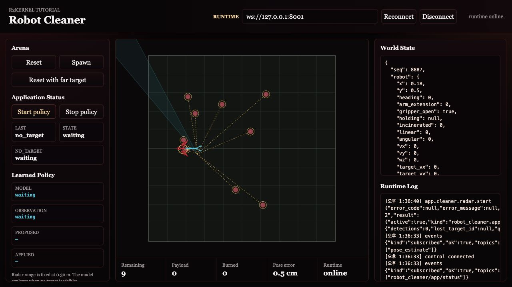
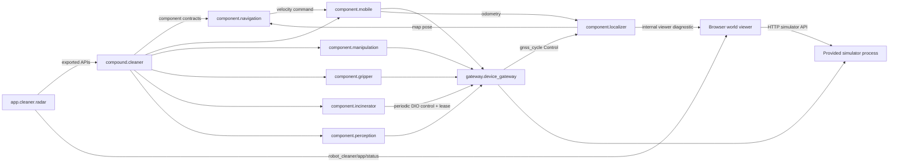

# Step 5 - Run Applications

This step runs the first complete cleaner robot behavior.

```text
same cleaner platform + selected application + deployment = robot behavior
```

The core tutorial runs Radar first. Radar needs no application-specific browser
frontend, so it is the cleanest way to see the completed platform become a
running robot. Teleoperation is still part of the tutorial, but it belongs in
the advanced flow because it introduces package installation, instance-scoped
frontend URLs, and the managed package frontend proxy.

The simulator and world viewer are still provided by `run_sim_world.py`. This
is the first step that uses `r2kernel deploy up` to reconcile the platform and an
application together. Earlier steps used `r2kernel launch run` so each
gateway/component/compound layer could be inspected on its own.

## 1. Run Radar Autonomy

Start the complete radar robot deployment from the installed root.

```text
cd <prefix>
r2kernel deploy up tutorials/deployments/radar.deployment.yaml --replace
```

Expected terminal output shape.

```text
Deployment up: ...
  - app.cleaner.radar [managed] started
  - component.mobile [managed] started
  - component.manipulation [managed] started
  - component.gripper [managed] started
  - component.incinerator [managed] started
  - component.perception [managed] started
  - component.localizer [managed] started
  - component.navigation [managed] started
  - compound.cleaner [managed] started
  - gateway.device_gateway [managed] started
```

If managed platform subsystems from earlier steps still match the desired
package, instance and launch settings, `deploy up` keeps them. `--replace`
permits replacing owned managed instances that need reconciliation. Same-name
unmanaged or federated registrations are conflicts, not instances to adopt.
A stop failure halts cleanup/relaunch; resolve the reported ownership or runtime
error rather than deleting session state. Missing instances are started.

## 2. Observe The Robot

Open the world viewer with the same host rule from Step 1. For a local browser
and runtime, use the following.

```text
http://127.0.0.1:8091/?app=app.cleaner.radar
```

For a remote runtime host, use the SSH forwarding from Step 1 and forward port
`8001` for runtime events and policy controls. The browser URL remains the local
URL above.

The world viewer automatically polls the simulator API and observes runtime app
status when the runtime is reachable. Use **Reconnect** only after restarting
the runtime or changing the network path. The `app` query parameter selects the
already-running application for the viewer's **Start policy** and **Stop policy**
controls. These controls invoke that application's behavior; they do not launch
subsystem processes or replace the deployment. `deploy up` starts the deployment.

The localizer publishes its standard typed estimate through `pose_estimate`.
The browser viewer subscribes to that same standard event.
The solid robot is simulator ground truth. The amber marker is the estimated
map pose, and **Pose error** reports their current planar distance. Ground truth
is exposed to the tutorial viewer; the Gateway receives receiver-shaped
simulated GNSS samples through its source adapter. The application receives
only relative radar detections and APIs exported by the compound.

The radar app uses the exported perception API as its target-selection input. It
chooses a trash target only when its latest radar observation is fresh and the
target is inside the configured scan range, then submits a framed goal through
the exported navigation API. Stale tracks remain visible for diagnostics but
cannot trigger a new navigation or collection command.
The tutorial mounts `cleaner_radar` 0.08 m forward and 0.03 m left of
`cleaner_base`, rotated 15 degrees about the vertical axis. The simulator
measures from this sensor pose, and navigation resolves the declared Spatial
transform before converting a sensor-relative goal into a map goal. Changing
only the mount declaration without changing the simulated physical sensor
would make the displayed frame graph and measurements disagree.
The viewer also draws the beam from the simulator-reported sensor pose, not
from the robot body's origin.
The App transforms each radar-relative target to the body frame to plan a
body-centered stand-off and calculate gripper extension. It expresses that
body goal back in the radar frame when calling navigation, so navigation's
own Spatial lookup is exercised as part of the tutorial.
`component.navigation` owns the localization feedback loop and periodic mobile
commands. When the goal succeeds, the app performs the collection sequence by
calling articulated-trajectory, gripper, and trigger APIs.
If no trash is inside range, the app reports `radar.no_target` and submits no
navigation goal.

The tutorial uses a deliberately limited range of `0.30` world units. The
seeded arena contains a reachable cluster and isolated trash outside that
cluster. Radar cleans what it can discover, then remains stopped with the
out-of-range trash still visible. This is intentional and demonstrates that
the application cannot act on objects its perception surface does not report.

The sensor does not reveal the full circle at once. Its beam rotates at
20 RPM, so one revolution takes three seconds; a nominal 100 ms acquisition
covers about 12 degrees. The Gateway returns bounded,
time-stamped sectors with range, bearing, and signal measurements as the beam
crosses objects. It does not return trash IDs, world coordinates, or a complete
360-degree detection list. The perception Component consumes those sectors and
maintains short-lived tracks with Component-owned IDs for the application's
`scan`, `front`, and `nearest` queries. The viewer may also show simulator
ground truth for teaching, but that is not part of the robot-facing radar
contract. The simulated sensor advances independently of the application loop,
so the beam continues rotating while collection and burning procedures run.
This tutorial uses the current Spatial transform for fresh observations; it
does not yet provide historical transform lookup at each return timestamp or
motion compensation across a moving robot's full revolution.

The application locks the first selected contact until collection completes or
the perception Component loses it. Contacts discovered during that action enter
a FIFO queue; a newer or closer contact does not replace the active target. The app
keeps that identity while it opens the gripper, extends the arm, closes the
gripper, retracts, and calls the standard trigger API through the compound's
`trash_disposal` export.

During navigation, `component.navigation` refreshes velocity commands while the
mobile component and simulator enforce their command TTLs. The app waits on the
navigation operation instead of implementing a drive controller. When the
target is close enough to collect, the app executes its explicit task sequence.
The compound does not contain a second navigation or collection algorithm.

The world viewer should show the cleaner arena without Teleop controls. Use
**Start policy** and **Stop policy** to control the running radar behavior.



Inspect the running deployment.

```text
r2kernel deploy status tutorials/deployments/radar.deployment.yaml
```

## 3. What The Deployment Adds

Open the radar deployment.

```text
nano tutorials/deployments/radar.deployment.yaml
```

The important fields are these.

| Field | Meaning |
| --- | --- |
| `robot` | the cleaner platform manifest used for slot validation |
| `application` | the selected app-role subsystem manifest |
| `instances` | package instances that should be running |
| `bindings` | how app requirements, spatial compound requirements, and component requirements connect |

The robot manifest selects component implementations through its slots. The
compound requires those component contracts and exports selected conformance
APIs. The app binds only to the compound boundary; the runtime resolves each
export to the implementing component without executing a compound proxy.

```text
app.cleaner.radar
  -> compound.cleaner API exports
  -> component.navigation / component.manipulation / component.gripper / component.perception
  -> component.incinerator
  -> component.mobile / component.localizer and component contracts
  -> gateway.device_gateway
  -> simulator
```

That is the point of the application layer. Radar describes robot behavior; it
does not need to know whether the gateway is a simulator, a lab gateway, or a
product device gateway.

## 4. Remote Host Reminder

For a remote runtime, keep the simulator ports on loopback and forward them as
described in [Step 1](start-simulation-world.md#if-the-runtime-is-remote).

```text
python3 tutorials/run_sim_world.py --host 127.0.0.1
```

Then start the radar deployment on that host.

```text
r2kernel deploy up tutorials/deployments/radar.deployment.yaml --replace
```

With SSH forwarding active, open this world viewer URL. Forward port `8001` as
well if the browser also needs to observe or control the runtime.

```text
http://127.0.0.1:8091/?app=app.cleaner.radar
```

The world viewer has no application selector. To switch robot behavior, stop
the active deployment or package instance and start the next application path.

## Runtime Graph

Open **Runtime > Graph** in the Web Console while the deployment is running.
The subsystem cards show the application-to-compound API exports,
compound-to-component contracts, and component-to-gateway controls represented
below. Enable the **Spatial** layer
on the same graph to see each component's attachment points and provided frames,
the cleaner's compound-owned mounts, and its provided frames. Enable
**Internal frames** to include each component's
static or dynamic transform. Select a spatial item to inspect its translation,
rotation, update time, and freshness.



## What This Proves

- A deployment can bring up a full platform plus a selected application.
- The application is the top-level behavior policy for the robot.
- Applications depend on compound-exported API contracts, not vendor-specific
  controller names or component topology.
- The world viewer is not the robot brain. It is a visualization and simulator
  control surface.
- The core tutorial can run an application without requiring package installation
  or a custom browser frontend.
- Teleoperation is an advanced topic because it adds managed package
  installation, package instance context, and package frontend proxy behavior.

When finished, stop the active deployment and then stop the world terminal.

```text
r2kernel deploy down tutorials/deployments/radar.deployment.yaml
```

Continue to [Advanced Subsystem Packages](advanced-subsystem-packages.md).
