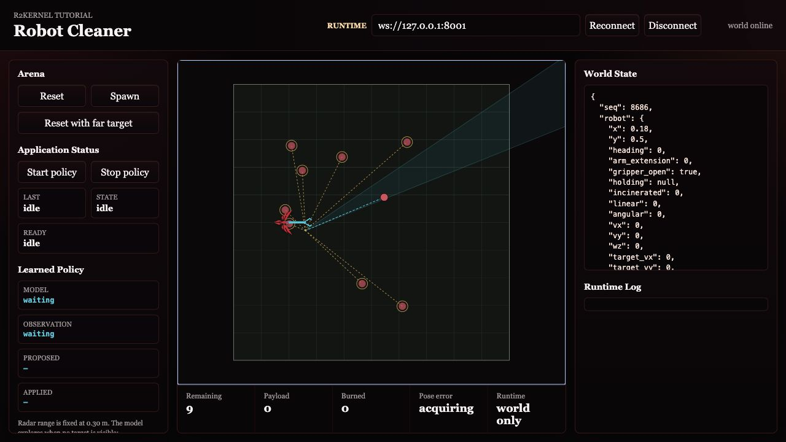
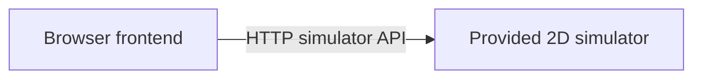

# Step 1 - Start Simulation World

Start with the provided 2D world. At this point there is no R2Kernel robot yet.
no gateway, no component, no platform, and no application.

The basic flow assumes the browser and R2Kernel runtime are on the same machine.
If you run the runtime on a remote Linux host, sandbox, or robot computer, use
the remote-host notes immediately after the local command.

## Goal

Run the simulator and browser view, then identify what the robot must control.

- a mobile base in a flat arena
- a simple arm extension
- a gripper
- trash objects
- a disposal action
- a scan result

## Run Locally

From the installed root, start the provided simulator and static browser
frontend.

```text
cd <prefix>
python3 tutorials/run_sim_world.py
```

Expected terminal output shape.

```text
[robot-cleaner] start simulator: ...
[robot-cleaner] start frontend: ...
[robot-cleaner] open http://127.0.0.1:8091/
[robot-cleaner] start robot subsystem packages from another terminal
```

Open this URL.

```text
http://127.0.0.1:8091/
```

## If The Runtime Is Remote

If R2Kernel is installed on a remote host and your browser is on another machine,
keep the tutorial services bound to the loopback interface and use SSH port
forwarding. The simulator API is unauthenticated and accepts state-changing
operations, so do not expose its ports to an untrusted network.

```text
. <prefix>/env.sh
cd <prefix>
python3 tutorials/run_sim_world.py --host 127.0.0.1
```

The frontend listens on port `8091`; the simulator API listens on port `8092`.
Forward both ports through SSH rather than opening them to the network.

```text
ssh -L 8091:127.0.0.1:8091 -L 8092:127.0.0.1:8092 <runtime-host>
```

Then open the local URL.

```text
http://127.0.0.1:8091/
```

## Remote URL Rule For Later Steps

Keep the simulation terminal open for the whole cleaner tutorial.

In later pages, commands such as `r2kernel launch run ... --set
simulator.url=http://127.0.0.1:8092` are run on the same runtime host as the
simulator, so `127.0.0.1` is still correct from the subsystem process point of
view.

Browser URLs use the browser's end of the connection. With the SSH forwarding
above, keep using the local address.

```text
http://127.0.0.1:8091/
```

When the robot application is running in later steps, open the same URL and
the page automatically observes app status when the runtime is reachable. The
frontend infers the simulator API on port `8092` and the runtime WebSocket on
port `8001` from the page host. Use **Reconnect** only after changing network
settings or restarting the runtime. Forward port `8001` as well when you need
runtime events or policy controls. Later application steps supply an `app` query
parameter to target the running application; that parameter does not start a
deployment. The `ws`, `sim`, and `connect` parameters are for automated tests or
unusual proxy layouts.

## Observe

The page polls the simulator API directly and attempts to attach to the runtime
event stream automatically. At this point, no application is running, so the
Application Status area may remain `idle`. That is expected.

Use the browser controls under Arena.

| Control | What it proves |
| --- | --- |
| Reset | the provided simulator owns world reset |
| Spawn | the provided simulator owns trash creation |
| World State | the browser can read robot pose, trash, score, and scan state |

This page is only the simulator and world viewer. Teleop controls belong to
the teleop application frontend that appears in the advanced teleop step.



## Open These Files

Open the simulator server.

```text
nano tutorials/simulator/arena_server.py
```

Open the simulator state model.

```text
nano tutorials/simulator/arena.py
```

Open the browser frontend.

```text
nano tutorials/frontend/app.js
```

You do not need to edit them in the normal tutorial path. They are provided
world infrastructure, similar to a small simulator, vendor SDK, or hardware test
environment.

## What Changed In The Robot Graph

Nothing yet. The graph has only tutorial support processes.



The next step adds the first R2Kernel subsystem through a managed launch.

## Verify

From the runtime host, the simulator health endpoint should respond.

```text
curl http://127.0.0.1:8092/health
```

The world state endpoint should respond.

```text
curl http://127.0.0.1:8092/state
```

From your browser machine, use the same local address after forwarding the
simulator port through SSH.

```text
curl http://127.0.0.1:8092/health
```

Keep this terminal open. Stop it with `Ctrl-C` only when you are finished with
the whole tutorial.

Continue to [Step 2 - Build Gateway Subsystem](build-gateway-subsystem.md).
