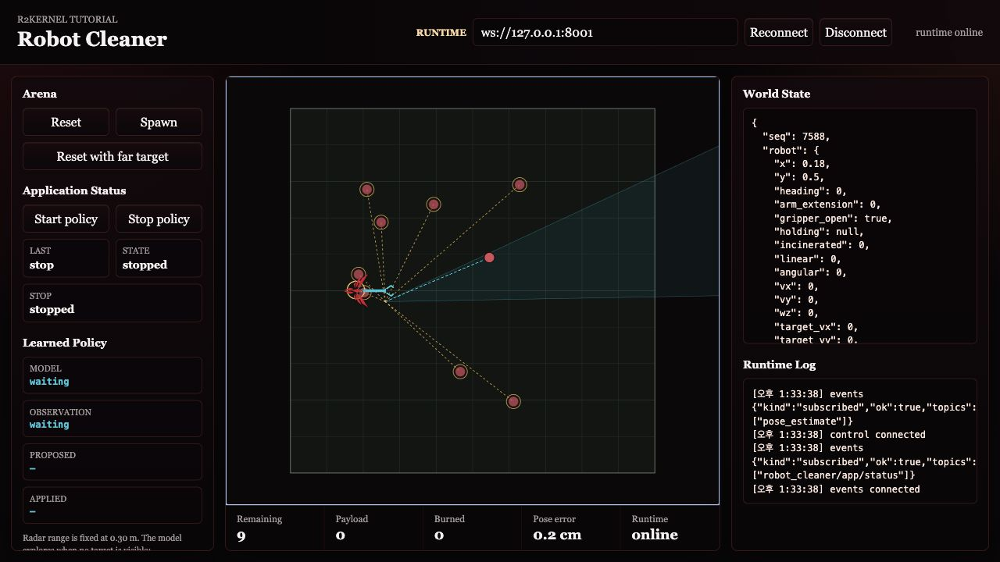
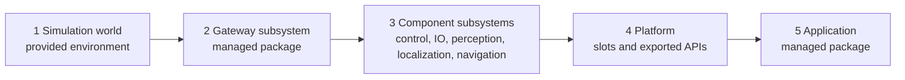

# Cleaner Robot Tutorial

This tutorial builds one visual robot using the same managed package path used
for a real robot. The provided script starts only the simulation world and
browser view. Individual robot subsystems are started with `r2kernel launch run`
while you learn each layer. The full robot is reconciled with
`r2kernel deploy up` after the platform and application are defined.



## What You Will Build

The platform is a set of managed subsystem packages.

```text
cleaner_2d
  gateway.device_gateway   simulator-backed gateway subsystem over standard contracts
  component.mobile           mobile-base component subsystem
  component.manipulation     manipulator component subsystem
  component.gripper          gripper component subsystem
  component.incinerator      lease-controlled disposal component subsystem
  component.perception       perception component subsystem
  component.localizer        GNSS position and odometry localization subsystem
  component.navigation       map-relative goal navigation subsystem
  compound.cleaner           spatial composition-only compound subsystem
```

The same platform can run three application packages.

| Application | Behavior |
| --- | --- |
| `app.cleaner.teleop` | operator drives, collects, and burns trash |
| `app.cleaner.radar` | range-limited perception-driven app searches for detected trash |
| `app.cleaner.learned_radar` | learned radar policy explores beyond the initial sensor range and collects trash |

## Execution Flow



`simulator/` and `frontend/` are tutorial infrastructure. They are not R2Kernel
subsystems. The R2Kernel robot starts at the gateway subsystem boundary.

The visible tutorial uses two browser surfaces.

| Surface | Where it appears | Purpose |
| --- | --- | --- |
| World viewer | `http://127.0.0.1:8091/` locally or through SSH forwarding | simulator display, reset/spawn controls, app status and start/stop controls |
| Package frontend | Runtime card for an installed package instance | operator controls owned by that application package |

In the advanced teleop step, keep both surfaces open side by side. The world
viewer shows what the robot is doing, and the teleop frontend sends commands
through the managed package frontend proxy.

## Launch Modes In This Tutorial

There are three ways you may see cleaner code run.

| Mode | Use | What R2Kernel manages |
| --- | --- | --- |
| `python3 path/to/subsystem.py` | source-level debugging while editing one subsystem | subsystem registration only |
| `r2kernel launch run <package>` | normal single-subsystem tutorial execution | package validation, resource lease, runtime env, lifecycle handle |
| `r2kernel deploy up <deployment>` | full robot and application execution | desired-state reconciliation across package instances |

Direct Python execution can still register a subsystem with the control backend
when you pass the right manifest and binding arguments. It is useful
for IDE/debugger work, but it is not a managed robot subsystem. It does not get
a launcher resource lease, package validation, package runtime directory, or
`r2kernel launch list/status/stop` lifecycle management.

For that reason, the tutorial uses `r2kernel launch run` while building
individual layers and introduces `r2kernel deploy up` only after the compound
subsystem layer, platform, and application are defined.

## Learned Radar Stop And Restart

The learned-radar app runs its policy in a worker. When the app receives Stop,
it cancels the active run. Once Stop returns, that canceled run sends no further
policy actuation. The worker checks cancellation after delayed scan calls and
before each policy-actuation step.

If a delayed scan worker is still running, the app keeps its worker reference
and rejects a restart until the worker exits. This prevents a new run from
overlapping the canceled one.

Stop waits for an in-progress synchronous actuation call to return and then
performs its own stop processing. This implementation does not establish a
bounded Stop response time. It does not guarantee an instantaneous physical
halt and is not a hardware emergency-stop mechanism. The tutorial tests this
behavior with deterministic in-memory concurrency unit tests; it has not been
verified on a physical device or Kubernetes cluster.

## Steps

| Step | Page | Primary command |
| --- | --- | --- |
| 1 | [Start Simulation World](start-simulation-world.md) | `python3 tutorials/run_sim_world.py` |
| 2 | [Build Gateway Subsystem](build-gateway-subsystem.md) | `r2kernel launch run tutorials/subsystems/gateway.device_gateway --instance gateway.device_gateway --set simulator.url=http://127.0.0.1:8092 --detach` |
| 3 | [Add Component Subsystems](add-component-subsystems.md) | `r2kernel launch run ... --bind ... --detach` |
| 4 | [Define Platform](define-platform.md) | `r2kernel launch run tutorials/subsystems/compound.cleaner --bind ... --detach` |
| 5 | [Run Applications](run-applications.md) | `r2kernel deploy up tutorials/deployments/radar.deployment.yaml --replace` |

Advanced topics after the robot is moving.

| Topic | Page |
| --- | --- |
| Package layout | [Subsystem Packages](advanced-subsystem-packages.md) |
| Managed teleop frontend | [Teleop Package Frontend](advanced-websocket-facade.md) |
| Resource control for managed packages | [Resource Policy](advanced-resource-policy.md) |
| Multi-host cleaner topology | [Federation](advanced-federation.md) |

## Repository Layout

```text
tutorials/
  simulator/                 provided simulation world
  frontend/                  browser world viewer
  robot/
    r2kernel.robot.yaml        robot manifest: parts and slots
  subsystems/                subsystem package roots
    component.mobile/        role=component package that implements the mobile-base component contract
    component.localizer/     role=component package that estimates map-relative robot pose
    component.navigation/    role=component package that executes map-relative navigation goals
    component.incinerator/   role=component package that owns the disposal output pulse and safety
    app.cleaner.teleop/      application subsystem package with managed package frontend
    app.cleaner.radar/       application subsystem package
  deployments/               deployment manifests for staged and app runs
  run_sim_world.py            simulation/frontend bootstrap only
```

Deployment files are split by purpose.

| Path | Level | Purpose |
| --- | --- | --- |
| `deployments/stages/gateway.deployment.yaml` | subsystem composition | start only the simulator-backed gateway subsystem |
| `deployments/stages/components.deployment.yaml` | subsystem composition | start gateway plus component subsystems and validate their bindings |
| `deployments/stages/robot.deployment.yaml` | platform bring-up | validate and run the app-less platform |
| `deployments/teleop.deployment.yaml` | full robot application manifest | validate or headlessly run the platform with the teleop app |
| `deployments/radar.deployment.yaml` | full robot application | run the platform with the perception-driven app |
| `deployments/dev/*.deployment.yaml` | external subsystem composition | binding data for source-level debugging where processes are started outside `deploy up` |

The `stages/gateway` and `stages/components` files intentionally omit
`robot`. They are partial subsystem compositions, not full robot deployments.
`stages/robot` includes `robot` but no `application`, so it checks the
app-less platform. The top-level app deployments include both `robot` and
`application`. The teleop browser controls use the Package install plus Runtime
launch path because package frontend URLs are tied to launched package
instances.

## Start Here

Use an installed R2Kernel runtime.

```text
. <prefix>/env.sh
r2kernel system status
```

Check Python SDK availability from the installed runtime.

```text
. <prefix>/env.sh
python3 -c 'import r2kernel; print("R2Kernel Python SDK ready")'
```

The installed `env.sh` exposes the unpacked SDK runtime used by managed
packages. Use a virtual environment or a matching source checkout only for
editable SDK development, as described in
[Developer Guide](../develop/developer-guide.md#installed-runtime-or-public-source-checkout).

Then start the visible world.

```text
cd <prefix>
python3 tutorials/run_sim_world.py
```

Open this URL.

```text
http://127.0.0.1:8091/
```

If R2Kernel is running on a remote host and your browser is on another machine,
keep the simulator bound to loopback and use SSH forwarding from Step 1.

```text
python3 tutorials/run_sim_world.py --host 127.0.0.1
```

Then open `http://127.0.0.1:8091/` through the forwarded ports. Step 1 explains
the simulator ports and the additional runtime port needed in later steps.

Continue to [Step 1 - Start Simulation World](start-simulation-world.md).
